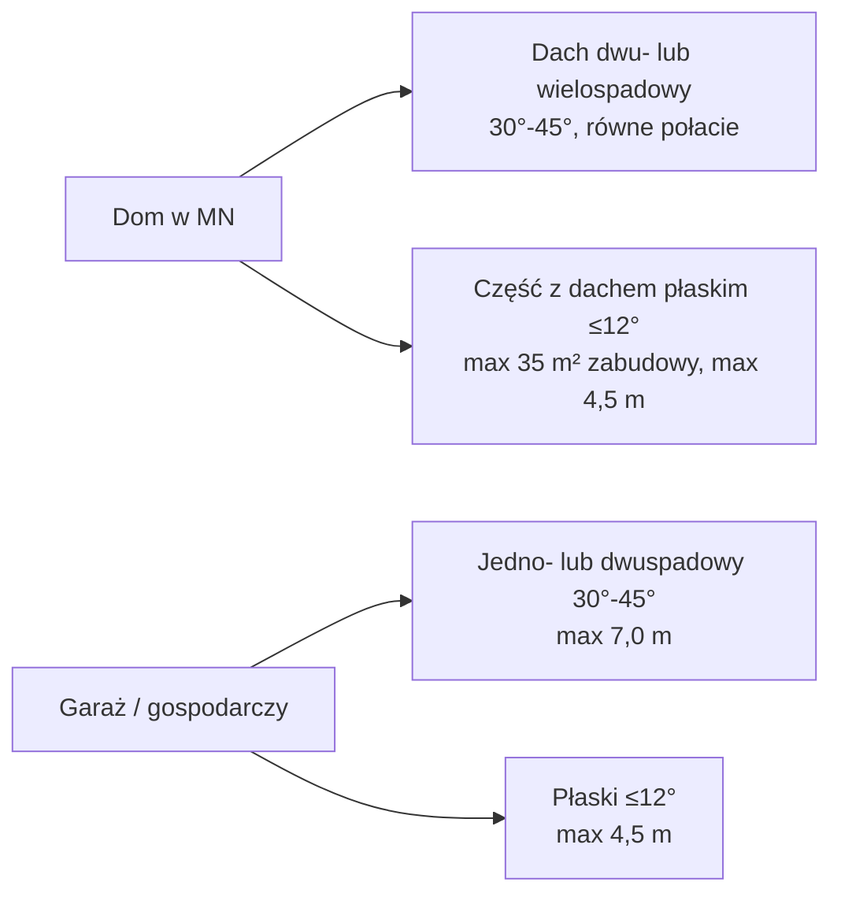

# Teren MN – zabudowa mieszkaniowa jednorodzinna (§26)

Ta strona zbiera **wszystkie** parametry dla terenów MN z planu Siepraw. Jeśli działka 2834/9 jest w terenie MN, te liczby decydują o domu i garażu. Część wskaźników zależy od numeru terenu – patrz tabela grup.

> [!info] Nasze działki: teren 3.22MN
> Wszystkie trzy działki (2834/8, 2834/9, 2834/11) leżą w terenie **3.22MN**. Wskaźniki dla 3.22MN: intensywność max 0,40 (§26 ust. 4 pkt 1 lit. b, grupa 3.1–24MN); PBC min 40% (§26 ust. 4 pkt 3 lit. a, grupa 3.1–26MN); zabudowa max 40% (§26 ust. 4 pkt 4 lit. a, grupa 3.1–26MN); nowo wydzielana działka min. 600 m² i front min. 16,0 m (§24 ust. 5 pkt 1 lit. a–b, grupa 3.1–26MN). Dowód: georeferowany raster planu z BIP (https://bip.malopolska.pl/api/files/3859132), wycinek `dzs-mpzp-rysunek-dzialki.png` ([[dzs-dokumenty-i-linki]]). Strona [[dzs-mpzp-teren-mn-u]] nas nie dotyczy.

## Gdzie są tereny MN

Symbole: 1.1–79MN (Czechówka), 2.1–28MN (Łyczanka), **3.1–208MN (Siepraw)**, 4.1–93MN (Zakliczyn) ([[dzs-mpzp-uchwala]] §26 ust. 1, §4 ust. 4 pkt 2).

## Tabela główna – parametry MN

| Parametr | Wartość | § |
|---|---|---|
| Przeznaczenie podstawowe | zabudowa mieszkaniowa jednorodzinna; **bez szeregowej i grupowej** | §26 ust. 2 |
| Przeznaczenie uzupełniające | handel detaliczny, usługi rzemieślnicze, gastronomia, droga wewnętrzna, ciąg pieszo-rowerowy, zieleń urządzona | §26 ust. 3 |
| Zawsze dozwolone | parkingi, dojazdy, **budynki gospodarcze i garaże**, altany, wiaty, mała architektura, infrastruktura | §25 ust. 1 |
| Max nadziemna intensywność | 0,80 / 0,40 / 0,30 – wg grupy (tabela niżej) | §26 ust. 4 pkt 1 |
| Min nadziemna intensywność | 0,001 | §26 ust. 4 pkt 2 |
| Min pow. biologicznie czynna | 40% lub 50% – wg grupy | §26 ust. 4 pkt 3 |
| Max pow. zabudowy | 40% / 30% / 25% – wg grupy | §26 ust. 4 pkt 4 |
| Miejsca parkingowe – dom | **min. 1 na 1 lokal mieszkalny** (także w garażu) | §26 ust. 5 pkt 1 |
| Miejsca parkingowe – lokal usługowy w domu | min. 1 na każde rozpoczęte 50,0 m² pow. użytkowej usług | §26 ust. 5 pkt 1 |
| Miejsca parkingowe – budynek usługowy | 1 na rozpoczęte 50,0 m² usług + 2 na 10 zatrudnionych, min. 1 | §26 ust. 5 pkt 2 |
| Max pow. zabudowy budynku usługowego | 500 m² | §26 ust. 6 pkt 1 |
| **Max wysokość domu – dach stromy** | **11,0 m** (budynek lub część pod dachem stromym) | §26 ust. 6 pkt 2 lit. a tiret 1 |
| Max wysokość domu – część z dachem płaskim | **4,5 m** | §26 ust. 6 pkt 2 lit. a tiret 2 |
| Max wysokość budynku usługowego | 8,0 m | §26 ust. 6 pkt 2 lit. b |
| **Max wysokość garażu / budynku gospodarczego – dach stromy** | **7,0 m** | §26 ust. 6 pkt 2 lit. c tiret 1 |
| Max wysokość garażu / gospodarczego – dach płaski | **4,5 m** | §26 ust. 6 pkt 2 lit. c tiret 2 |
| Max wysokość innych obiektów (wiata, altana itd.) | 4,5 m | §26 ust. 6 pkt 2 lit. d |
| **Dach domu – rodzaj** | **dwu- lub wielospadowy** | §26 ust. 6 pkt 3 lit. a |
| **Dach domu – kąt** | **30°–45°**, jednakowe nachylenie głównych połaci | §26 ust. 6 pkt 3 lit. a |
| Dach płaski na domu | tylko **część** budynku o pow. zabudowy **≤ 35,0 m²** | §26 ust. 6 pkt 3 lit. a |
| Dach na łuku | tylko zabudowa usługowa | §26 ust. 6 pkt 3 lit. a |
| **Dach garażu / gospodarczego** | **jedno- lub dwuspadowy 30°–45°** albo **płaski** | §26 ust. 6 pkt 3 lit. b |
| Lukarny, okna połaciowe | dozwolone | §26 ust. 6 pkt 3 lit. c |
| Taras / parking na dachu płaskim | dozwolony | §26 ust. 6 pkt 3 lit. d |
| Kolor dachu stromego | ciemniejszy niż ściany | §25 ust. 3 pkt 1 |
| Kolory zakazane | jaskrawe (intensywnie żółte, zielone, fioletowe, niebieskie), materiały odblaskowe | §25 ust. 3 pkt 3 |
| Zielony dach, zielona elewacja | dozwolone | §25 ust. 3 pkt 2 i 4 |
| Linia zabudowy od drogi | wg rysunku planu; schody, ganek, dach, balkon, wykusz i taras mogą wystawać do 2,0 m przed linię | [[dzs-mpzp-uchwala]] §22 ust. 1, §3 ust. 1 pkt 11 |
| Budynek 1,5 m od granicy lub w granicy | plan: gdy front działki **< 16,0 m** (§23 ust. 1). Niezależnie od tego WT §12 ust. 4 pkt 3: garaż lub budynek gospodarczy (dł. ≤ 6,5 m, wys. ≤ 3 m) przy granicy albo ≥ 1,5 m od niej, ścianą bez okien i drzwi. WT §12 ust. 3: budynek przy granicy, gdy przylega całą długością ściany do budynku sąsiada. Taki budynek obejmuje działkę sąsiada obszarem oddziaływania (WT §12 ust. 5) | [[dzs-mpzp-uchwala]] §23 ust. 1; WT Dz.U. 2022 poz. 1225 §12 (zm. Dz.U. 2023 poz. 2442) |
| Min pow. nowej działki | 600 / 800 / 1200 m² – wg grupy | §24 ust. 5 pkt 1 lit. a |
| Min front nowej działki | 16,0 m | §24 ust. 5 pkt 1 lit. b |
| Kąt granic nowej działki do drogi | ok. 90°; dopuszczalnie 60°–120° | §24 ust. 4 |
| Tolerancja parametrów podziału | –10%, tylko gdy wielkość dzielonej działki nie pozwala zachować parametrów z §24 ust. 5 ([[dzs-mpzp-uchwala]] §24 ust. 6) | §24 ust. 6 |
| Dojazd nie wydzielony | min. 5,0 m szerokości | §24 ust. 7 |
| Telekomunikacja | tylko infrastruktura „o nieznacznym oddziaływaniu” | §53 ust. 7 pkt 3 |
| OZE wolnostojące (PV na gruncie) | dozwolone **do 100 kW** | §55 pkt 3 |
| Wiatrak | tylko mikroinstalacja | §55 pkt 1 lit. b |
| Biogaz | zakaz | §55 pkt 1 lit. a |
| Obiekty tymczasowe | zakaz (poza czasem budowy) | §19 ust. 4 |
| Ogrodzenie, kalenica, pokrycie dachu, liczba kondygnacji | **plan nie reguluje** | brak w §1–§58 |

Wysokość mierzy się od średniej z najniższego i najwyższego poziomu terenu na obwodzie ścian zewnętrznych budynku do najwyższego punktu dachu, ściany lub attyki. Komina i wyjścia technicznego nie wlicza się ([[dzs-mpzp-uchwala]] §3 ust. 1 pkt 22; upzp Dz.U. 2026 poz. 538 art. 2 pkt 30 lit. a). Na całej działce 2834/9 teren ma 313,71–317,02 m n.p.m. (PL-KRON86-NH), czyli różnica ok. 3,3 m (gis/dzs-summary.json). Różnica na obwodzie budynku zależy od miejsca budynku.

## Wskaźniki wg grupy symboli (wyjątki per symbol)

| Grupa symboli | Max intensywność | Min PBC | Max pow. zabudowy | Min nowa działka | § |
|---|---|---|---|---|---|
| 1.1MN, 1.72MN, **3.25MN** | 0,80 | 40% | 40% | 600 m² | §26 ust. 4 pkt 1 lit. a, pkt 3 lit. a, pkt 4 lit. a; §24 ust. 5 |
| 1.2MN, 2.1–7MN, **3.1–24MN, 3.26MN, 3.203MN** | 0,40 | 40% | 40% | 600 m² | §26 ust. 4 pkt 1 lit. b, pkt 3 lit. a, pkt 4 lit. a; §24 ust. 5 |
| 1.3–66MN, 1.73MN, 1.76–78MN, 2.8–28MN, **3.27–181MN, 3.197–200MN, 3.202MN, 3.204–207MN**, 4.1–82MN, 4.93MN | 0,30 | 40% | 30% | 800 m² | §26 ust. 4 pkt 1 lit. c, pkt 3 lit. b, pkt 4 lit. b; §24 ust. 5 |
| 1.67–71MN, 1.74–75MN, 1.79MN, **3.182–196MN, 3.201MN, 3.208MN**, 4.83–92MN | 0,30 | 50% | 25% | 1200 m² | §26 ust. 4 pkt 1 lit. d, pkt 3 lit. c, pkt 4 lit. c; §24 ust. 5 |

Wysokości, dachy i parkingi są **takie same** we wszystkich grupach MN (§26 ust. 5–6).

> [!question] Do sprawdzenia
> 3.25MN jest w grupie intensywności 0,80 (§26 ust. 4 pkt 1 lit. a), a w grupach PBC i zabudowy jako część „3.1–26MN” (40% / 40%). 3.26MN ma intensywność 0,40. Plan nie wymienia pary „3.25–26” razem przy intensywności – to wygląda na celowe rozróżnienie, nie błąd.

## Przykład liczbowy (wyliczenie, nie cytat z planu)

Wyliczenie dla powierzchni z oferty: 2834/9 = 777 m²; 2834/8 + 2834/9 = 1610 m² ([[dzs-oferta-i-mail-z57]]). Wzór: wskaźnik × powierzchnia działki budowlanej.

| Grupa | Działka | Max pow. zabudowy | Min PBC | Max suma kondygnacji nadziemnych |
|---|---|---|---|---|
| 0,40 / 40% / 40% | 777 m² | 310,8 m² | 310,8 m² | 310,8 m² |
| 0,30 / 40% / 30% | 777 m² | 233,1 m² | 310,8 m² | 233,1 m² |
| 0,30 / 50% / 25% | 777 m² | 194,3 m² | 388,5 m² | 233,1 m² |
| 0,30 / 40% / 30% | 1610 m² | 483,0 m² | 644,0 m² | 483,0 m² |
| 0,30 / 50% / 25% | 1610 m² | 402,5 m² | 805,0 m² | 483,0 m² |

> [!warning]
> Wskaźniki liczy się od **działki budowlanej** (upzp art. 2 pkt 29, 32, 35). Działka budowlana może obejmować kilka działek ewidencyjnych, jeśli razem spełniają warunki (upzp art. 2 pkt 12). 2834/8 i 2834/9 są w jednej księdze wieczystej KR1Y/00091772/7; 2834/11 jest w innej (KR1Y/00059868/1). Czy urząd przyjmie kilka działek jako jedną działkę budowlaną – zapytaj projektanta i starostwo ([[dzs-starostwo-myslenice]]).

> [!warning]
> Garaż i budynek gospodarczy wliczają się do powierzchni zabudowy i do intensywności (upzp art. 2 pkt 32, 35). Podjazd z kostki **nie** jest powierzchnią biologicznie czynną. PBC to teren, który zapewnia naturalną wegetację roślin i retencję wód opadowych i roztopowych (upzp Dz.U. 2026 poz. 538 art. 2 pkt 28). Tarasy i stropodachy z roślinnością (np. zielony dach) liczą się w 50%, jeśli mają co najmniej 10 m². Kostka ażurowa: zależy od interpretacji urzędu.

## Co oznacza dach w praktyce

- Dom z dachem jednospadowym: **nie** (§26 ust. 6 pkt 3 lit. a).
- Dom „kostka” z dachem płaskim w całości: **nie** – płaski tylko część do 35 m² (§26 ust. 6 pkt 3 lit. a).
- Garaż z dachem płaskim i tarasem: **tak** (§26 ust. 6 pkt 3 lit. b i d).
- Garaż jednospadowy 30°–45°: **tak** (§26 ust. 6 pkt 3 lit. b).

## Wyjątki per symbol – podsumowanie

Tekst §26 rozróżnia symbole **tylko** we wskaźnikach intensywności, PBC, zabudowy i w minimalnej działce (§24 ust. 5). Wysokości, dach, parkingi i przeznaczenie są wspólne dla wszystkich terenów MN. Nie znaleźliśmy innych wyjątków dla konkretnych symboli MN w §1–§58.

## Weryfikacja

- 2026-10-27: sprawdzono ze źródłami pierwotnymi; poprawiono 5 miejsc (zob. [[dzs-raport-weryfikacji-2026-10-27]]).

## Powiązane

- [[dzs-mpzp-uchwala]] · [[dzs-mpzp-definicje]] · [[dzs-mpzp-ustalenia-ogolne]] · [[dzs-mpzp-teren-mn-u]] · [[dzs-mpzp-infrastruktura-i-komunikacja]]
- [[dzs-warunki-techniczne-odleglosci]] · [[dzs-dzialka-2834-9]] · [[dzs-planer-dzialki-dom]] · [[dzs-szybkie-odpowiedzi]]
- [[dzialki-siepraw]] · [[dzs-pomysly]] · [[dzs-slownik]]
