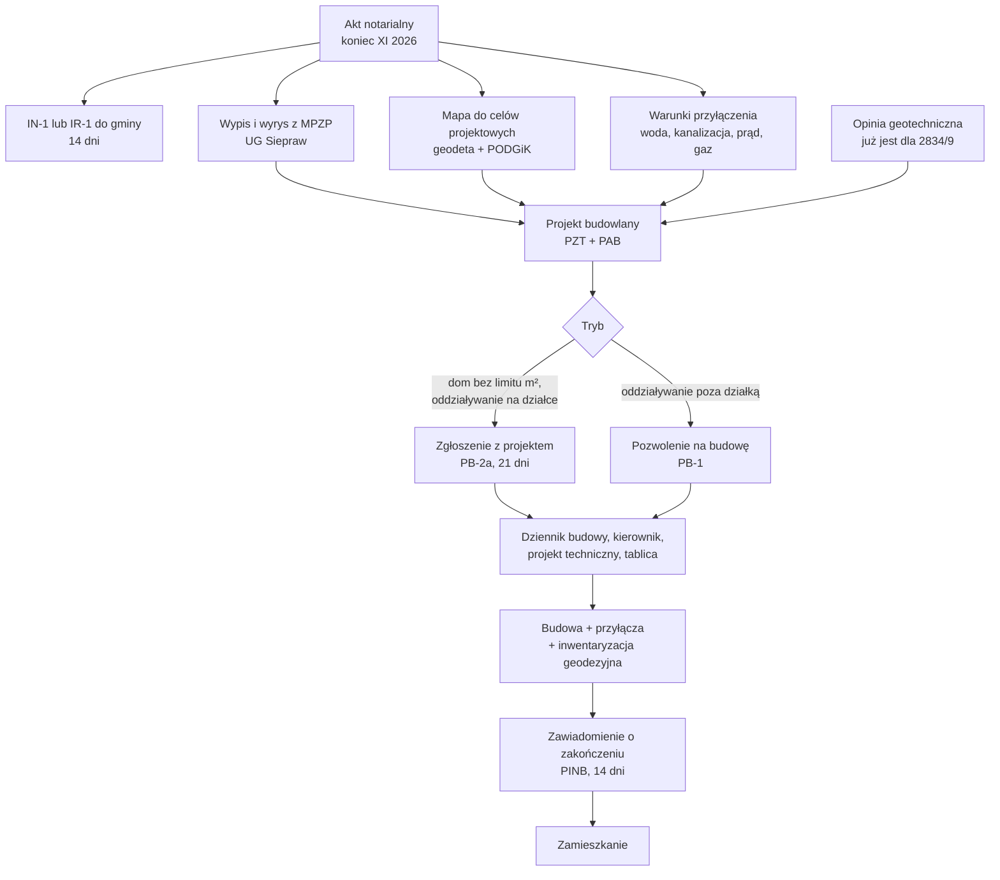

# Procedura budowy: od zakupu do zamieszkania

Ta strona pokazuje kolejne kroki od zakupu działek do zamieszkania w domu na 2834/9. Przy każdym kroku podaje urząd, czas i koszt, jeśli jest źródło. Brak źródła oznacza „do sprawdzenia”.

## Schemat

## Kroki

| # | Krok | Kto / gdzie | Czas | Koszt | Źródło |
|---|---|---|---|---|---|
| 0 | Sprawdzenie KW, EGiB, MPZP przed aktem | Wy, EKW, UG, Starostwo | przed aktem | wypis/wyrys od 50 zł | [[dzs-checklista-przed-zakupem]] |
| 1 | Akt notarialny | notariusz | koniec XI 2026 | patrz [[dzs-koszty-zakupu-i-podatki]] | [[dzs-oferta-i-mail-z57]] |
| 2 | Informacja IN-1 (podatek od nieruchomości) albo IR-1 (podatek rolny – gdy grunt jest w EGiB użytkiem rolnym) | UG Siepraw, pok. 29 | 14 dni od aktu | 0 zł | art. 6 ust. 6 ustawy o podatkach i opłatach lokalnych |
| 3 | Wypis i wyrys z MPZP | UG Siepraw, pok. 15 | do 1 miesiąca | wypis 30/50 zł; wyrys 20 zł/A4, maks. 200 zł | https://samorzad.gov.pl/web/gmina-siepraw/gospodarka-gruntami-i-planowanie-przestrzenne |
| 4 | Mapa do celów projektowych (układ wysokości PL-EVRF2007-NH – do potwierdzenia z geodetą) | uprawniony geodeta; PODGiK Myślenice | do sprawdzenia | do sprawdzenia (oferta geodety) | PODGiK Myślenice – zgłoszenie pracy geodezyjnej przez geodetę (karta 1754; strona nie opisuje mapy do celów projektowych): https://myslenicki.pl/wykaz-spraw/1754/zgloszenia-prac-geodezyjnych |
| 5 | Warunki przyłączenia: woda, kanalizacja | UG Siepraw | do sprawdzenia | zwykle 0 zł za warunki | https://samorzad.gov.pl/web/gmina-siepraw/wodociagi-i-kanalizacja2 |
| 6 | Warunki przyłączenia: prąd | TAURON Dystrybucja | do 21 dni (grupa V) | opłata przyłączeniowa ok. 73,63 zł/kW (źródło wtórne) | [[dzs-dostawcy-mediow]] |
| 7 | Uzgodnienie i usunięcie kolizji z linią (jeśli dom koliduje) | TAURON | termin usunięcia kolizji – do sprawdzenia (ustala go porozumienie z TAURON; dla porównania przebudowa przyłącza przez TAURON trwa min. 12 mies. od umowy: https://www.tauron-dystrybucja.pl/przylaczenie-do-sieci/przebudowa-przylacza) | uzgodnienie: 80 zł netto za 1. arkusz A4 (dokumentacja prosta) albo 83 zł (złożona); przebudowa wg porozumienia z TAURON | https://www.tauron-dystrybucja.pl/uslugi-dystrybucyjne/uzgodnienia-branzowe |
| 8 | Warunki przyłączenia: gaz (opcjonalnie) | PSG Kraków | do sprawdzenia | do sprawdzenia | [[dzs-dostawcy-mediow]] |
| 9 | Projekt budowlany: PZT + projekt architektoniczno-budowlany (3 egz.) | projektant z uprawnieniami | do sprawdzenia | do sprawdzenia | https://myslenicki.pl/wykaz-spraw/1742/zgloszenie-zamiaru-budowy-lub-przebudowy-budynku-mieszkalnego-je |
| 10 | Zgłoszenie z projektem (PB-2a + PB-5) | Starostwo Myślenice, Drogowców 2a albo e-Budownictwo | 21 dni na sprzeciw | 0 zł | art. 29 ust. 1 pkt 1, art. 30 ust. 5 Prawa budowlanego |
| 10a | albo pozwolenie na budowę (PB-1) | Starostwo Myślenice | 1–2 miesiące wg karty sprawy | 0 zł opłaty skarbowej za pozwolenie na budowę domu mieszkalnego (sprawy budownictwa mieszkaniowego, art. 2 ust. 1 pkt 2 ustawy o opłacie skarbowej; t.j. Dz.U. 2025 poz. 1154, nowszy t.j. Dz.U. 2026 poz. 1395). Pełnomocnictwo: 17 zł. | https://myslenicki.pl/wykaz-spraw/1741/pozwolenie-na-budowe-zmiane-pozwolenia |
| 11 | Projekt techniczny (konstrukcja, instalacje) | projektant | przed robotami | do sprawdzenia | art. 42 ust. 1 pkt 1 Prawa budowlanego |
| 12 | Kierownik budowy | osoba z uprawnieniami | przed robotami | do sprawdzenia | art. 42 ust. 1 pkt 2 Prawa budowlanego |
| 13 | Dziennik budowy (gdy jest kierownik budowy, art. 45) | papierowy: Starostwo, Wydział Architektury (wydaje do 31.12.2029); elektroniczny EDB: e-dziennikbudowy.gunb.gov.pl | 3 dni robocze | 0 zł | https://myslenicki.pl/wykaz-spraw/1736/ |
| 14 | Zawiadomienie o rozpoczęciu robót, tablica informacyjna, wytyczenie budynku przez geodetę | PINB; geodeta | przed robotami | do sprawdzenia | art. 41 ust. 4–4a (zawiadomienie PINB i projektanta sprawującego nadzór), art. 43 ust. 1 pkt 2 (wytyczenie przez geodetę), art. 45a ust. 1 pkt 3 lit. a (tablica informacyjna) Prawa budowlanego |
| 15 | Budowa domu i przyłączy | wykonawcy | do sprawdzenia | do sprawdzenia | – |
| 16 | Geodezyjna inwentaryzacja powykonawcza (dom + przyłącza) | geodeta | po budowie | do sprawdzenia | art. 43 ust. 1 pkt 2 Prawa budowlanego; dokumentację dołącz do zawiadomienia o zakończeniu budowy (art. 57 ust. 1 pkt 5) |
| 17 | Zawiadomienie o zakończeniu budowy | PINB Myślenice | 14 dni na sprzeciw | do sprawdzenia | art. 54 ust. 1 Prawa budowlanego |
| 18 | Numer porządkowy, IN-1 po zmianie (budynek) | UG Siepraw | po zakończeniu | 0 zł | https://samorzad.gov.pl/web/gmina-siepraw/gospodarka-gruntami-i-planowanie-przestrzenne |

Tekst Prawa budowlanego: Dz.U. 2026 poz. 524 (https://api.sejm.gov.pl/eli/acts/DU/2026/524/text.pdf). Zmiany po t.j.: Dz.U. 2026 poz. 605, 646, 1161 i 1347. Ustawa 1161 dodała art. 102a–102c. Przez 18 miesięcy od 20.09.2026 projekt (PZT, PAB i projekt techniczny) może być zrobiony wg przepisów technicznych (art. 7 ust. 2 pkt 1) obowiązujących do 19.09.2026, jeśli inwestor złoży oświadczenie (art. 102a ust. 1–2). Nowe rozporządzenie o warunkach technicznych nie było ogłoszone w Dz.U. do 27.10.2026 (wyszukiwanie ELI; money.pl 4.10.2026). Ustal z projektantem, które WT stosuje i czy złożyć oświadczenie.

## Wybór trybu – krótko

- **Zgłoszenie z projektem (art. 29 ust. 1 pkt 1):** dom wolno stojący, bez limitu powierzchni. Obszar oddziaływania musi zmieścić się na Waszych działkach. Potrzebny kierownik budowy i projekt techniczny.
- **Zgłoszenie „do 70 m²” (art. 29 ust. 1 pkt 1a):** max 2 kondygnacje, do 70 m² zabudowy, na własne potrzeby. Kierownik budowy i dziennik budowy nie są wymagane (art. 42 ust. 1 pkt 2 lit. b, art. 45), ale inwestor przejmuje odpowiedzialność za kierowanie budową (art. 30 ust. 2a pkt 7). Projekt techniczny jest wymagany (art. 42 ust. 1 pkt 1 lit. b). Do zgłoszenia dołącz oświadczenie o własnych potrzebach mieszkaniowych pod rygorem karnym (art. 30 ust. 2a pkt 6). Budowę można zacząć po doręczeniu zgłoszenia, bez czekania 21 dni (art. 30 ust. 5j–5k). Garaż wbudowany wlicza się do powierzchni zabudowy (do sprawdzenia z projektantem).
- **Pozwolenie na budowę:** gdy obszar oddziaływania wychodzi poza działki albo gdy Starostwo nałoży ten obowiązek w decyzji o sprzeciwie (art. 30 ust. 7 Prawa budowlanego), np. przy zagrożeniu bezpieczeństwa ludzi lub mienia albo naruszeniu MPZP. Nie dotyczy trybu „do 70 m²” (art. 30 ust. 5j).

Szczegóły i karty spraw: [[dzs-starostwo-myslenice]].

## Co już macie, a co musicie zamówić

| Dokument | Status | Gdzie |
|---|---|---|
| Opinia geotechniczna dla 2834/9 | jest | [[dzs-opinia-geotechniczna]], [[dzs-warunki-gruntowe]] |
| Tekst i rysunek MPZP | jest (kopie) | [[dzs-mpzp-uchwala]] |
| Dane NMT 1 m (PL-KRON86-NH), poziomice, spadki | jest (orientacyjnie) | [[dzs-dane-gis-i-3d]] |
| Wypis i wyrys z MPZP (urzędowy) | do zamówienia | UG Siepraw |
| Mapa do celów projektowych (PL-EVRF2007-NH – do potwierdzenia z geodetą) | do zamówienia | geodeta |
| Warunki przyłączeń | do zamówienia po akcie | [[dzs-dostawcy-mediow]] |
| Uzgodnienie z TAURON (linia przy N granicy) | do zamówienia | [[dzs-dostawcy-mediow]] |

> [!warning] Teren na stoku i osuwiska
> Działka 2834/9 ma średni spadek ok. 12,9% i opada na S ([[dzs-dane-gis-i-3d]]). Jeśli działka leży w obszarze osuwisk wskazanym na rysunku MPZP, obowiązuje zakaz rozsączania ścieków i wód opadowych w gruncie oraz nakaz odprowadzania wód opadowych do rowu, cieku lub kanalizacji opadowej. Budowa jest dopuszczona zgodnie z przepisami odrębnymi, w tym o konieczności wykonania dokumentacji geologiczno-inżynierskiej ([[dzs-mpzp-uchwala]] § 12 ust. 1–3). Sprawdź to na wyrysie i w [[dzs-warunki-gruntowe]].

> [!question] Do sprawdzenia
> Koszty geodety, projektanta, kierownika budowy i przyłączy. Nie mam źródła oficjalnego. Zbierz 2–3 oferty lokalne.

## Weryfikacja

- 2026-10-27: sprawdzono ze źródłami pierwotnymi; poprawiono 10 miejsc (zob. [[dzs-raport-weryfikacji-2026-10-27]]).

## Powiązane

- [[dzialki-siepraw]] · [[dzs-harmonogram]]
- [[dzs-starostwo-myslenice]] · [[dzs-urzad-gminy-siepraw]] · [[dzs-dostawcy-mediow]]
- [[dzs-mpzp-teren-mn]] · [[dzs-warunki-techniczne-odleglosci]] · [[dzs-warunki-gruntowe]]
- [[dzs-koszty-zakupu-i-podatki]] · [[dzs-checklista-przed-zakupem]] · [[dzs-ryzyka]]
- [[dzs-szybkie-odpowiedzi]] · [[dzs-pomysly]] · [[dzs-slownik]]
