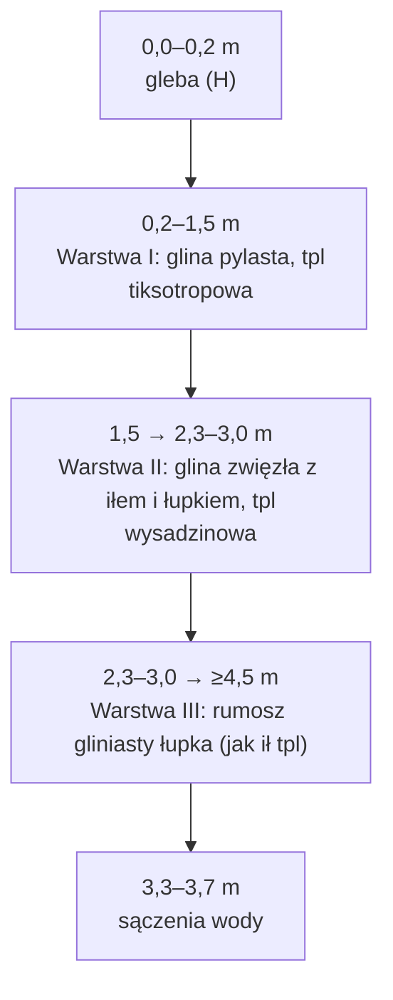

# Warunki gruntowe – działka 2834/9

Ta strona mówi, jaki grunt i jaka woda są pod domem na działce 2834/9. Pomaga szybko odpowiedzieć na pytania o fundamenty, piwnicę, drenaż i odprowadzenie wody. Źródło: opinia z maja 2022 r. ([[dzs-opinia-geotechniczna]]).

## W skrócie

| Pytanie | Odpowiedź | Źródło |
|---|---|---|
| Warunki gruntowe | proste | [[dzs-opinia-geotechniczna]] s. 4, s. 8 |
| Kategoria geotechniczna | II (propozycja; ustala projektant) | s. 4, s. 8 |
| Grunt | gliny twardoplastyczne, niżej rumosz gliniasty łupka | s. 6, s. 8 |
| Woda | sączenia 3,3–3,7 m p.p.t., ustabilizowane 3,4 m (otwór 13) | s. 8 |
| Przemarzanie | ok. 1,0 m p.p.t. | s. 10 |
| Fundament | zalecana płyta fundamentowa | s. 9 |
| Studnia chłonna / oczyszczalnia | **nie** – opinia odradza („Nie należy wykonywać”, [[dzs-opinia-geotechniczna]] s. 9, wniosek 14). MPZP dopuszcza te rozwiązania ([[dzs-mpzp-uchwala]] § 53 ust. 3 pkt 4 i pkt 8), ale nie w obszarach osuwisk z § 12. Decyduje projektant | s. 9 |
| Deszczówka | poza działkę: kanalizacja deszczowa albo zbiornik szczelny | s. 9 |

## Warstwy gruntu

Pod 0,2 m gleby są trzy warstwy. Wszystkie są małowilgotne (mw) i twardoplastyczne (tpl), IL = 0,15 ([[dzs-opinia-geotechniczna]] s. 6, s. 13–15).

| Głębokość (m p.p.t.) | Warstwa | Grunt | Stan | Parametry charakterystyczne | Źródło |
|---|---|---|---|---|---|
| 0,0–0,2 | gleba (H) | grunt próchniczny | – | – (opinia nie podaje zaleceń; ogólna praktyka: zdjąć warstwę glebową przed budową) | s. 13–15, s. 19 (zał. 5) |
| 0,2–1,5 | I | glina pylasta (Gπ), miejscami przewarstwiona pyłem; brązowo-szara | tpl, IL 0,15, mw | wn 20%, ρ 2,10 t/m³, c 19 kPa, φ 16°, M0 32 900 kPa, E0 23 000 kPa | s. 6, s. 7 |
| 1,5–1,6 → 2,3–3,0 | II | glina zwięzła / glina pylasta zwięzła z iłem, z rumoszem łupka i piaskowca; brązowo-popielata | tpl, IL 0,15, mw | wn 22%, ρ 2,00 t/m³, c 19 kPa, φ 16°, M0 32 900 kPa, E0 23 000 kPa | s. 6, s. 7 |
| od 2,3–3,0 do ≥ 4,5 (nieprzewiercona) | III | rumosz gliniasty łupka, miejscami z rumoszem piaskowca; ciemnopopielaty | parametry jak ił tpl, IL 0,15, mw | wn 27%, ρ 2,00 t/m³, c 51 kPa, φ 12°, M0 27 200 kPa, E0 15 300 kPa | s. 6, s. 7 |

Strop warstwy III w otworach: 12 – 2,30 m; 13 – 3,00 m; 14 – 2,50 m ([[dzs-opinia-geotechniczna]] s. 13–15).

Tekst opinii (s. 6) podaje strop warstwy II na 1,5–1,6 m i strop warstwy III na 2,5–3,0 m. Karty otworów (s. 13–15) i przekrój 4.1 podają strop warstwy II na 1,50 m we wszystkich otworach i strop warstwy III na 2,30 m w otworze 12. Tu przyjęto wartości z kart.

Do obliczeń projektant stosuje współczynnik materiałowy γm = 0,9 lub 1,1 ([[dzs-opinia-geotechniczna]] s. 8).

> [!warning] Grunt wrażliwy na wodę i drgania
> - Warstwa I jest tiksotropowa. Przy zawilgoceniu lub przy obciążeniach dynamicznych (np. drganiach) jej parametry geotechniczne mogą się nagle pogorszyć ([[dzs-opinia-geotechniczna]] s. 9, wniosek 6).
> - Warstwy II i III są wysadzinowe i mogą mocno pęcznieć (s. 9, wniosek 7).
> - Ogranicz ciężki sprzęt. Zagęszczaj bez wibracji (s. 10, wniosek 17).

## Woda gruntowa

| Otwór | Rzędna terenu | Woda nawiercona (sączenie) | Woda ustabilizowana | Rzędna wody (obliczona) | Źródło |
|---|---|---|---|---|---|
| 12 | 315,80 m n.p.m. | 3,30 m p.p.t. | – | ok. 312,50 m | s. 13 |
| 13 | 314,70 m n.p.m. | 3,70 m p.p.t. (intensywne) | 3,40 m p.p.t. | ok. 311,30 m | s. 8, s. 14 |
| 14 | 314,90 m n.p.m. | 3,60 m p.p.t. | – | ok. 311,30 m | s. 15 |

- To nie jest stałe zwierciadło. To woda z opadów i roztopów, która krąży na granicach warstw (s. 8).
- Poziom może się mocno zmieniać z pogodą (s. 8).
- Badania były wiosną. Autor uznaje warunki wodne w czasie wierceń za niekorzystne ([[dzs-opinia-geotechniczna]] s. 8). Poziom wody „może ulegać znacznym wahaniom” zależnie od opadów (s. 8). Wniosek: po dużych lub długich opadach woda może być wyżej niż w kwietniu 2022 r.

> [!question] Do sprawdzenia
> Opinia nie podaje układu wysokości dla „m n.p.m.”. Rzędne wody to nasze obliczenie: rzędna terenu minus głębokość. Nasz NMT jest w PL-KRON86-NH (313,7–317,0 m, [[dzs-dane-gis-i-3d]]). Projekty używają PL-EVRF2007-NH. Różnicę uwzględnia geodeta lub projektant.

## Kategoria i warunki gruntowe

- Warunki gruntowe: **proste** ([[dzs-opinia-geotechniczna]] s. 4, s. 8).
- Kategoria geotechniczna: proponowana **II**. Ostatecznie ustala ją projektant (s. 4, s. 8).
- Podstawa: rozporządzenie MTBiGM z 25.04.2012 r. (Dz.U. 2012 poz. 463) (s. 4).

> [!question] Do sprawdzenia
> Przy II kategorii rozporządzenie zawsze wymaga, oprócz opinii, dokumentacji badań podłoża gruntowego i projektu geotechnicznego (Dz.U. 2012 poz. 463, § 7 ust. 2, https://api.sejm.gov.pl/eli/acts/DU/2012/463/text.html). Rozporządzenie podaje 1–2-kondygnacyjny dom w prostych warunkach gruntowych jako przykład I kategorii (§ 4 ust. 3 pkt 1 lit. a). Przy I kategorii wystarczy opinia (§ 7 ust. 1). Opinia proponuje II kategorię, a ostatecznie ustala ją projektant ([[dzs-opinia-geotechniczna]] s. 4, s. 8). Zapytaj projektanta, którą kategorię przyjmie i czy ta opinia z 2022 r. mu wystarczy. Może zlecić nowe badania pod konkretny dom.

## Strefa przemarzania

- hz ≈ **1,0 m p.p.t.** ([[dzs-opinia-geotechniczna]] s. 10, wniosek 19).
- Przy ławach fundament schodzi poniżej tej głębokości. Przy płycie projektant stosuje izolację termiczną pod płytą i na obrzeżu. To ogólna zasada; szczegóły ustala konstruktor.

## Zalecenia fundamentowania

| Temat | Co mówi opinia | Źródło |
|---|---|---|
| Typ fundamentu | zalecana **płyta fundamentowa** | s. 9, wniosek 8 |
| Jedna warstwa | posadowić cały dom w jednej warstwie geotechnicznej | s. 9, wniosek 8 |
| Głębokość | założenie zleceniodawcy: ok. 1,2–2,0 m p.p.t.; ostatecznie decyduje konstruktor | s. 4, s. 9 |
| Dno wykopu | przed fundamentami potwierdzić parametry gruntu w dnie wykopu; wszystkie prace ziemne pod nadzorem geologa z uprawnieniami | s. 9, wnioski 9 i 15 |
| Wymiana gruntu | gdy w dnie wystąpią grunty słabonośne: wymienić lub wzmocnić | s. 9, wniosek 10 |
| Drenaż | drenaż podziemny i powierzchniowy, starannie zaprojektowany | s. 9, wniosek 11 |
| Deszczówka | odprowadzić poza działkę: kanalizacja deszczowa albo zbiornik szczelny | s. 9, wniosek 12 |
| Szczelność | szczelne przyłącza wody i kanalizacji | s. 9, wniosek 13 |
| Wykopy | etapami, pod nadzorem geologa z uprawnieniami; w okresie suchym; przy opadach chronić wykop przed wodą (np. folią); nie kopać w czasie intensywnych opadów, po nich poczekać, aż grunt przeschnie; ściany głębszych wykopów zabezpieczyć przed obrywaniem; przy istniejących sieciach kopać ręcznie, przy przedstawicielach ich użytkowników | s. 9–10, wnioski 15–16 |
| Sprzęt | jak najmniej ciężkiego sprzętu; zagęszczanie bez wibracji | s. 10, wniosek 17 |
| Izolacje przeciwwodne | opinia nie podaje szczegółów | – |

> [!warning] Głębokość 1,2–2,0 m to granica warstw I i II
> Strop warstwy II jest na 1,5–1,6 m. Opinia zaleca posadowienie w jednej warstwie (s. 6, s. 9). Projektant musi dobrać poziom płyty tak, aby nie stała na dwóch różnych gruntach.

## Piwnica: tak czy nie?

- Zleceniodawca założył dom **bez piwnicy** (s. 4).
- Opinia nie zakazuje wprost piwnicy.
- Woda sączy się od 3,3 m p.p.t. Dno piwnicy byłoby zwykle na ok. 2,5–3,0 m. To blisko wody i w warstwach pęczniejących II/III.
- Teren opada na południe ze spadkiem ok. 12,9% ([[dzs-dane-gis-i-3d]]). Woda z opadów spływa po stoku i wsiąka w grunt.

> [!warning] Piwnica = większe ryzyko i koszt
> Nie planuj piwnicy bez nowej opinii geotechnicznej. Piwnica wymaga szczelnej konstrukcji („biała wanna” lub ciężka izolacja) i drenażu. To nasz wniosek z danych opinii, nie zapis opinii.

## Rozsączanie, szambo, oczyszczalnia

| Rozwiązanie | Ocena | Źródło |
|---|---|---|
| Studnia chłonna / skrzynki rozsączające | **nie** – opinia odradza („Nie należy wykonywać”, [[dzs-opinia-geotechniczna]] s. 9, wniosek 14). MPZP dopuszcza te rozwiązania ([[dzs-mpzp-uchwala]] § 53 ust. 3 pkt 4 i pkt 8), ale nie w obszarach osuwisk z § 12. Decyduje projektant | s. 9, wniosek 14 |
| Przydomowa oczyszczalnia z drenażem | **nie** – opinia odradza („Nie należy wykonywać”, [[dzs-opinia-geotechniczna]] s. 9, wniosek 14). MPZP dopuszcza te rozwiązania ([[dzs-mpzp-uchwala]] § 53 ust. 3 pkt 4 i pkt 8), ale nie w obszarach osuwisk z § 12. Decyduje projektant | s. 9, wniosek 14 |
| Deszczówka do kanalizacji deszczowej | tak, jeśli istnieje | s. 9, wniosek 12 |
| Zbiornik szczelny na deszczówkę | tak | s. 9, wniosek 12 |
| Szambo (zbiornik szczelny) | możliwe technicznie; mail sprzedającego zapowiada w umowie „konkretne zobowiązania dotyczące terminowej budowy sieci kanalizacyjnej”, ale nie mówi, kto ją zbuduje i do kiedy | [[dzs-oferta-i-mail-z57]], [[dzs-uzbrojenie-terenu]] |

- Opinia nie mierzy przepuszczalności. Gliny i iły twardoplastyczne słabo przepuszczają wodę. To wiedza ogólna.

> [!question] Do sprawdzenia
> Czy w ulicy jest lub będzie kanalizacja deszczowa? Jeśli nie, zaplanuj zbiornik szczelny na deszczówkę. Sprawdź też, co plan miejscowy mówi o wodach opadowych ([[dzs-mpzp-infrastruktura-i-komunikacja]]).

## Spadek terenu i osuwiska

- Teren opada na południe. Wysokość na 2834/9: 313,7–317,0 m (PL-KRON86-NH), średni spadek ok. 12,9% ([[dzs-dane-gis-i-3d]]).
- Rzędne otworów to potwierdzają: 315,80 m (12, północ) i 314,70–314,90 m (13, 14, południe) ([[dzs-opinia-geotechniczna]] s. 13–15).
- Opinia wspomina „charakter terenu” przy odwodnieniu (s. 9). Nie ocenia osuwisk ani stateczności zbocza.

> [!question] Do sprawdzenia
> Sprawdź działki w rejestrze osuwisk SOPO (PIG-PIB) i w planie miejscowym ([[dzs-mpzp-ustalenia-ogolne]]). Opinia tego nie robi.

## Agresywność wód

- Opinia nie bada agresywności wody wobec betonu ani stali.

> [!question] Do sprawdzenia
> Zapytaj projektanta, czy potrzebna jest analiza wody. Przy płycie nad poziomem sączeń (3,3 m) zwykle nie jest to kluczowe, ale decyduje projektant.

## Weryfikacja

- 2026-10-27: sprawdzono ze źródłami pierwotnymi; poprawiono 10 miejsc (zob. [[dzs-raport-weryfikacji-2026-10-27]]).

## Powiązane

- [[dzs-opinia-geotechniczna]]
- [[dzs-dzialka-2834-9]]
- [[dzs-dane-gis-i-3d]]
- [[dzs-uzbrojenie-terenu]]
- [[dzs-mpzp-infrastruktura-i-komunikacja]]
- [[dzs-procedura-budowy]]
- [[dzs-ryzyka]]
- [[dzs-szybkie-odpowiedzi]]
- [[dzialki-siepraw]]
- [[dzs-pomysly]] · [[dzs-checklista-przed-zakupem]] · [[dzs-slownik]]
