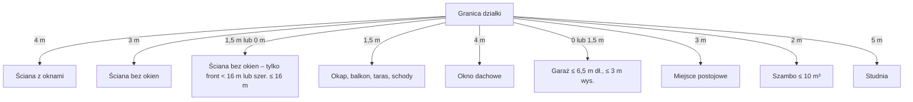

# Warunki techniczne – odległości od granicy i innych obiektów

Ta strona podaje odległości z przepisów ogólnych: dom i garaż od granicy, okna, parking, szambo, studnia, las, ppoż. Uzupełnia MPZP ([[dzs-mpzp-teren-mn]]). Najpierw przeczytaj ramkę o stanie prawnym.

> [!warning] Stan prawny na 2026-10-27 – rozporządzenie z 2002 r. utraciło moc
> - Rozporządzenie Ministra Infrastruktury z 12.04.2002 r. w sprawie warunków technicznych, jakim powinny odpowiadać budynki i ich usytuowanie („WT”) ma w ISAP status **„uznany za uchylony”**, data uchylenia **2026-09-21** (https://api.sejm.gov.pl/eli/acts/DU/2002/690, odczyt 2026-10-27). Podstawa uchylenia w ISAP: ustawa z 19.07.2019 r. o zapewnianiu dostępności (Dz.U. 2019 poz. 1696).
> - **Nowego rozporządzenia nie znaleźliśmy** w Dzienniku Ustaw 2026 (przegląd ISAP, 1393 pozycje, 2026-10-27). Branża potwierdza lukę: https://inzynierbudownictwa.pl/nowych-warunkow-technicznych-nie-ma-co-dalej/
> - **Okres przejściowy**: ustawa z 31.07.2026 r. (Dz.U. 2026 poz. 1161) dodała do Prawa budowlanego art. 102a–102c. Przez **18 miesięcy od 20.09.2026 r.** (czyli do ok. 20.03.2028 r.) projekt do pozwolenia na budowę lub do zgłoszenia może być sporządzony wg WT „obowiązujących do dnia 19 września 2026 r.” – **po złożeniu oświadczenia inwestora** o stosowaniu tych przepisów (art. 102a ust. 1). Wtedy także projekt techniczny robi się wg tych przepisów (art. 102a ust. 2), a decyzje dla całej inwestycji opierają się na nich (art. 102a ust. 4). Dom na zgłoszenie (PB art. 29 ust. 1 pkt 1 lub 1a, t.j. Dz.U. 2026 poz. 524) jest objęty art. 102a ust. 1 pkt 3 (Dz.U. 2026 poz. 1161). Do zgłoszenia trzeba dołączyć oświadczenie inwestora. Art. 102b pozwala stosować stare WT bez oświadczenia, ale tylko przy budowie z art. 29 ust. 2 i robotach z art. 29 ust. 4. Są to prace bez pozwolenia i bez zgłoszenia, np. ogrodzenie do 2,20 m (art. 29 ust. 2 pkt 20).
> - Zgłoszenie z art. 29 ust. 1 pkt 1 działa tylko wtedy, gdy obszar oddziaływania domu mieści się w całości na działce inwestora. **Wniosek**: dom w granicy albo 1,5 m od granicy (WT §12 ust. 2–4) obejmuje działkę sąsiada obszarem oddziaływania (§12 ust. 5). Wtedy zgłoszenie z pkt 1 może nie wystarczyć. Projektant musi to potwierdzić.
> - **Wniosek dla nas**: wszystkie liczby niżej to **stan prawny do 19.09.2026 r.**, stosowany na podstawie art. 102a. Złóż wniosek lub zgłoszenie z oświadczeniem przed ok. 20.03.2028 r. Po tej dacie obowiązują nowe przepisy, których dziś nie znamy.

## Teksty, z których czytamy

| Akt | Dz.U. | Plik | ISAP |
|---|---|---|---|
| WT – tekst jednolity | Dz.U. 2022 poz. 1225 (obwieszczenie z 15.04.2022) | `dzs-wt-dz-u-2022-1225-tj.pdf` | https://isap.sejm.gov.pl/isap.nsf/DocDetails.xsp?id=WDU20220001225 |
| WT – zmiana (m.in. §12, §20, §39, §40) | Dz.U. 2023 poz. 2442, w życie 01.08.2024 (pierwotnie 01.04.2024; termin przesunęło Dz.U. 2024 poz. 474 §1 pkt 2) | `dzs-wt-zmiana-dz-u-2023-2442.pdf` | https://isap.sejm.gov.pl/isap.nsf/DocDetails.xsp?id=WDU20230002442 |
| WT – zmiana zmiany (przesunięcie wejścia w życie całej zmiany 2023 poz. 2442 na 01.08.2024 oraz nowe brzmienie §56a i §85a) | Dz.U. 2024 poz. 474 | – (przeczytany, nie zapisany) | https://isap.sejm.gov.pl/isap.nsf/DocDetails.xsp?id=WDU20240000474 |
| WT – zmiana (§12 ust. 1a, 10a; ppoż.) | Dz.U. 2024 poz. 726, w życie 3 mies. od ogłoszenia (14.05.2024) | – (przeczytany, nie zapisany) | https://isap.sejm.gov.pl/isap.nsf/DocDetails.xsp?id=WDU20240000726 |
| Prawo budowlane – art. 102a–102c | Dz.U. 2026 poz. 1161 | `dzs-ustawa-dz-u-2026-1161.pdf` | https://isap.sejm.gov.pl/isap.nsf/DocDetails.xsp?id=WDU20260001161 |
| Prawo budowlane – tekst jednolity | Dz.U. 2026 poz. 524 | – (przeczytany) | https://isap.sejm.gov.pl/isap.nsf/DocDetails.xsp?id=WDU20260000524 |

Pliki leżą w folderze assets tej sekcji. Brzmienie §12 niżej uwzględnia zmiany z 2023 i 2024 r.

> [!question] Do sprawdzenia
> Nie ma oficjalnego tekstu jednolitego WT z zmianami z 2023–2024 r. Złożyliśmy go sami z t.j. 2022 i aktów zmieniających. Projektant powinien potwierdzić brzmienie.

## Dom od granicy działki (WT §12)

| Sytuacja | Min. odległość | Przepis |
|---|---|---|
| Ściana **z oknami lub drzwiami** zwrócona do granicy | **4 m** | §12 ust. 1 pkt 1 |
| Ściana **bez okien i drzwi** zwrócona do granicy | **3 m** | §12 ust. 1 pkt 2 |
| Ściana z oknami **nierównoległa** do granicy | **3–4 m**, gdy zewnętrzna krawędź okna/drzwi jest **≥ 4 m** od granicy | §12 ust. 1a (od 2024) |
| Każda płaszczyzna załamanej ściany | traktowana jako osobna ściana | §12 ust. 1 (część wspólna, od 2024) |
| Ściana bez okien i drzwi **w granicy lub min. 1,5 m od granicy** | tylko gdy **MPZP to przewiduje** | WT §12 ust. 2 (brzmienie z Dz.U. 2023 poz. 2442, w życie 01.08.2024) + [[dzs-mpzp-uchwala]] §23 ust. 1 (front < 16,0 m) |
| W granicy przy ścianie budynku sąsiada | gdy przylega **całą długością ściany** do budynku sąsiada i wysokość zgodna z MPZP | §12 ust. 3 |
| Zabudowa jednorodzinna, działka o szerokości **≤ 16 m** | ściana bez okien w granicy lub **min. 1,5 m** | §12 ust. 4 pkt 1 |
| Okap, gzyms, balkon, daszek, taras, schody zewnętrzne | **min. 1,5 m** od granicy | §12 ust. 6 pkt 1 |
| Okno dachowe zwrócone do granicy | **min. 4 m** | §12 ust. 6 pkt 2 |
| Okap przy budynku z ust. 2 i 4 | wolno zbliżyć **do 1 m** | §12 ust. 7 |
| Część podziemna (całkowicie pod terenem) | odległości nie ustala się | §12 ust. 9 |
| Sąsiednia działka jest **drogowa** lub publicznym placem | odległości z ust. 1–9 **nie obowiązują** | §12 ust. 10 |
| Skutek ust. 2–4 | sąsiednia działka jest w obszarze oddziaływania (sąsiad jest stroną) | §12 ust. 5 |

> [!warning] Sprzeczność
> MPZP §23 ust. 1: front „mniejszy niż 16,0 m”. WT §12 ust. 4 pkt 1: działka „o szerokości 16 m lub mniejszej”. To dwie różne miary (front vs szerokość) i dwie różne granice (< 16 vs ≤ 16). §12 ust. 4 pkt 1 WT działa sam, bez zgody planu. Projektant musi wskazać, jak mierzy szerokość działki.

> [!tip] Pomysł
> Granica z działką drogową: §12 ust. 10 znosi odległości 4 m / 3 m. Linia zabudowy z MPZP (§22) nadal obowiązuje. Jeśli wschodnia granica 2834/9 przylega do działki drogowej, dom może stać bliżej tej granicy – w granicach linii zabudowy.

## Garaż i budynek gospodarczy przy granicy

Dwie drogi prawne:

| Droga | Warunki | Przepis |
|---|---|---|
| A – każda działka jednorodzinna | garaż/gospodarczy **długość ≤ 6,5 m**, **wysokość ≤ 3 m**; w granicy albo **≥ 1,5 m** ścianą bez okien i drzwi | WT §12 ust. 4 pkt 3 |
| B – wąska działka | dowolny budynek ścianą bez okien 1,5 m od granicy lub w granicy; front **< 16,0 m** (MPZP) lub szerokość ≤ 16 m (WT) | MPZP §23 ust. 1 + WT §12 ust. 2; WT §12 ust. 4 pkt 1 |
| Garaż w granicy – ppoż. | ściana od sąsiada jako ściana oddzielenia przeciwpożarowego | WT §272 ust. 3 |
| Budynek gospodarczy z oknami | **min. 8 m** od ściany domu sąsiada (istniejącego lub z pozwoleniem/zgłoszeniem) | WT §12 ust. 8 |

§12 ust. 4 pkt 3 WT mówi o budowie budynku gospodarczego lub garażu. **Wniosek**: drogę A stosuje się na pewno do wolnostojącego garażu albo budynku gospodarczego. Garaż wbudowany w dom albo do niego dobudowany jest najpewniej częścią domu. Wtedy obowiązują odległości domu: 4 m albo 3 m (§12 ust. 1), albo 1,5 m lub w granicy na drodze B (§12 ust. 2 z MPZP §23 ust. 1, albo §12 ust. 4 pkt 1). Projektant musi potwierdzić, jak traktuje garaż przy domu na 2834/9.

> [!warning]
> Garaż w MPZP może mieć do 7,0 m (dach stromy) lub 4,5 m (płaski) ([[dzs-mpzp-teren-mn]]). Ale w granicy na drodze A wolno tylko **3 m** wysokości i **6,5 m** długości (WT §12 ust. 4 pkt 3). Garaż dwustanowiskowy ok. 6 × 6 m ma oba boki ≤ 6,5 m. Większy garaż, np. 6 × 7 m, może nie spełnić limitu 6,5 m. Przepis (WT §12 ust. 4 pkt 3) nie mówi, który wymiar to „długość”. **Wniosek**: najbezpieczniej przyjąć, że ≤ 6,5 m ma ściana przy granicy. Projektant musi potwierdzić, jak mierzy długość.

## Przesłanianie i nasłonecznienie (WT §13, §60)

| Zasada | Wartość | Przepis |
|---|---|---|
| Przesłanianie okna pokoju | w kącie 60° od okna nie może być obiektu bliżej niż jego **wysokość przesłaniania** (obiekty ≤ 35 m) | §13 ust. 1 pkt 1 lit. a |
| Pomiar wysokości przesłaniania | od dolnej krawędzi najniższych okien do najwyższej krawędzi obiektu przesłaniającego | §13 ust. 2 |
| Wąski obiekt (maszt, komin) | min. 10 m od okna, szerokość ≤ 3 m | §13 ust. 3 |
| Nasłonecznienie pokoju | **min. 3 godziny** w dniach równonocy, 7:00–17:00; w mieszkaniu wielopokojowym – przynajmniej 1 pokój | §60 ust. 1–2 |

## Dojazd do działki (WT §14)

| Zasada | Wartość | Przepis |
|---|---|---|
| Dojście i dojazd do drogi publicznej | obowiązkowy; szerokość jezdni **min. 3 m** | §14 ust. 1 |
| Ciąg pieszo-jezdny | min. 5 m | §14 ust. 2 |
| Dojazd nie wydzielony (MPZP) | min. 5,0 m | MPZP §24 ust. 7 |

## Miejsca postojowe (WT §19–§21)

| Zasada | Wartość | Przepis |
|---|---|---|
| Parking do 10 miejsc – od okien pokoi w budynku mieszkalnym | **7 m** | §19 ust. 1 pkt 1 lit. a |
| Parking do 10 miejsc – od granicy działki | **3 m** | §19 ust. 2 pkt 1 lit. a |
| Wyjątek od 7 m | **1–2 niezadaszone miejsca na 1 lokal przy domu jednorodzinnym** – 7 m od okien nie obowiązuje | §19 ust. 5 |
| Wyjątek od 3 m | 1–2 niezadaszone miejsca w zabudowie jednorodzinnej, **gdy stykają się z niezadaszonym parkingiem sąsiada** | §19 ust. 6 |
| Wyjątek od 3 m | sąsiednia działka jest drogowa | §19 ust. 7 |
| Wymiary miejsca | **2,5 × 5 m**; dla osoby z niepełnosprawnością 3,6 × 5 m | §21 ust. 1 |
| Nawierzchnia | utwardzona lub gruntowa stabilizowana, ze spadkiem | §21 ust. 3 |

> [!warning]
> Wyjątek §19 ust. 5 dotyczy **okien**, nie granicy. Niezadaszone miejsce dla domu musi stać **3 m od granicy**, chyba że sąsiad ma parking w tym samym miejscu albo sąsiednia działka jest drogowa (§19 ust. 6–7). Wiata garażowa to miejsce „zadaszone” – wyjątki ust. 5–6 jej nie obejmują.

## Śmietnik (WT §22–§23)

W zabudowie jednorodzinnej odległości miejsca na pojemniki od okien (10 m) i od granicy (3 m) **nie są określone** (§23 ust. 4).

## Studnia (WT §31)

| Od osi studni do | Min. odległość | Przepis |
|---|---|---|
| granicy działki | **5 m** (mniej lub studnia wspólna – gdy zachowane pkt 2–5 na obu działkach) | §31 ust. 1 pkt 1, ust. 2 |
| osi rowu przydrożnego | 7,5 m | §31 ust. 1 pkt 2 |
| szamba, kompostu, budynku inwentarskiego | **15 m** | §31 ust. 1 pkt 3 |
| drenażu przydomowej oczyszczalni (ścieki oczyszczone biologicznie) | **30 m** | §31 ust. 1 pkt 4 |
| drenażu bez biologicznego oczyszczania, pola filtracyjnego | 70 m | §31 ust. 1 pkt 5 |

## Szambo i przydomowa oczyszczalnia (WT §34–§37)

Odległości szamba (WT §36 ust. 1–3) mierzy się od pokrywy i wylotu wentylacji zbiornika, nie od ściany zbiornika.

| Zasada | Wartość | Przepis |
|---|---|---|
| Kiedy wolno szambo | **tylko** gdy działka **nie ma możliwości przyłączenia do kanalizacji** | §34 ust. 1 |
| Budowa szamba | dno i ściany nieprzepuszczalne, odpowietrzenie min. 0,5 m nad terenem | §35 |
| Szambo do 10 m³, dom jednorodzinny – od okien i drzwi zewnętrznych do pomieszczeń na pobyt ludzi | **5 m** | §36 ust. 2 pkt 1 |
| Szambo do 10 m³, dom jednorodzinny – od granicy, drogi, chodnika | **2 m** | §36 ust. 2 pkt 2 |
| Szambo przy granicy | wolno, gdy po drugiej stronie jest podobne urządzenie sąsiada | §36 ust. 5 |
| Szambo 10–50 m³ | 30 m od okien, 7,5 m od granicy, 10 m od drogi | §36 ust. 3 |
| Osadnik przydomowej oczyszczalni | wolno tuż przy domu, odpowietrzenie 0,6 m ponad okna | §37 |
| Działka bez kanalizacji | dom wolno postawić z szambem lub oczyszczalnią do 5 m³ ścieków/dobę | §26 ust. 3 |
| Deszczówka | dla budynków niskich: na własny teren, do dołów chłonnych, zbiorników | §28 ust. 2 |
| Spływ na sąsiada | zakaz kierowania wód opadowych na działkę sąsiada | §29 |

> [!warning]
> Plan dopuszcza szambo i oczyszczalnię (MPZP §53 ust. 3 pkt 4). Ale WT §34 ust. 1 zakazuje szamba, gdy działka może być przyłączona do kanalizacji. Mail zapowiada w umowie zobowiązania dotyczące terminowej budowy sieci, ale nie mówi, kto buduje i do kiedy. Wniosek: najpewniej sprzedający – ustal w akcie ([[dzs-oferta-i-mail-z57]]). **Wniosek**: jeśli w dniu złożenia projektu działka będzie miała możliwość przyłączenia do kanalizacji, WT §34 ust. 1 nie pozwoli na nowe szambo. Wyjątek: szambo z decyzją wydaną na podstawie Prawa wodnego (§34 ust. 2). §34 ust. 1 zakazuje też szamba na obszarach szczególnej ochrony środowiska, na obszarach narażonych na powódź i na terenach zalewowych. Przy osuwisku (MPZP §12) odpada drenaż rozsączający oczyszczalni.

> [!question] Do sprawdzenia
> - Czy szambo, które już stoi, trzeba zastąpić przyłączem, gdy powstanie sieć (ustawa o utrzymaniu czystości i porządku w gminach). Tego tekstu nie pobraliśmy.
> - Pozwolenie wodnoprawne lub zgłoszenie wodnoprawne dla oczyszczalni z drenażem i dla studni głębinowej – wymagania z Prawa wodnego. Tego nie pobraliśmy.

## Ppoż. – odległości między budynkami i od lasu (WT §271–§273)

| Zasada | Wartość | Przepis |
|---|---|---|
| Dom jednorodzinny do 3 kondygnacji | zwolniony z wymagań klasy odporności pożarowej | §213 pkt 1 lit. a |
| Garaż wolnostojący do 2 miejsc, budynek gospodarczy do 2 kondygnacji | zwolnione jw. | §213 pkt 2 lit. b, pkt 3 |
| Odległość ZL–ZL (ściany z klasą odporności ogniowej E na > 65% powierzchni) | **8 m** | WT §271 ust. 1 |
| Dom jednorodzinny (§213) bez pomieszczeń zagrożonych wybuchem | 8 m można zmniejszyć o 25% do **6 m**, gdy budynki są zwrócone do siebie ścianami i dachami z przekryciami nierozprzestrzeniającymi ognia, bez otworów | WT §271 ust. 9 |
| Ściana lub dach jednego budynku rozprzestrzenia ogień | +50% (12 m); obu – +100% (16 m) | §271 ust. 2 |
| Dom jednorodzinny od granicy niezabudowanej działki sąsiada | jak w §12 (ściany i dachy nierozprzestrzeniające ognia) | §272 ust. 2 |
| Budynek w granicy | ściana oddzielenia przeciwpożarowego od strony sąsiada | §272 ust. 3 |
| Budynki na jednej działce | odległości nie ustala się (poza wyjątkami) | §273 ust. 1 |
| Od lasu (grunt „Ls” lub teren L w MPZP) | jak odległość od budynku ZL **z dachem rozprzestrzeniającym ogień** – w praktyce zwykle **12 m** (8 m + 50%) | §271 ust. 8 w zw. z ust. 1–2 |
| Od lasu – wyjątek | 4 m od granicy lasu na sąsiedniej działce; na własnej działce – nie określa się. Warunki: teren lasu w MPZP przeznaczony pod zabudowę niezwiązaną z produkcją leśną; dom z §213 z elementów nierozprzestrzeniających ognia, bez pomieszczeń zagrożonych wybuchem, z klasą odporności pożarowej wyższą niż wymagana w §212 | WT §271 ust. 8a |
| Zbiornik oleju opałowego naziemny | 10 m od budynku ZL (3 m przy ścianie REI 120) | §273 ust. 2–3 |

> [!question] Do sprawdzenia
> - Czy w pobliżu jest las „Ls” lub teren L? MPZP §23 ust. 2 odsyła do tych przepisów. Sprawdź ewidencję.
> - Odległość 12 m od lasu to nasz wniosek z §271 ust. 1, 2 i 8. Projektant potwierdzi wartość dla konkretnych ścian.

## Linie energetyczne i inne sieci

Strefy wzdłuż linii zależą od napięcia i od wymagań operatora. Ani WT, ani MPZP nie podają liczby metrów dla linii nN/SN. MPZP §53 ust. 1 pkt 4 odsyła do przepisów odrębnych; §53 ust. 1 pkt 6 pozwala przebudować sieć przy kolizji.

> [!question] Do sprawdzenia
> Nie pobraliśmy: wytycznych operatora (TAURON Dystrybucja) o pasach dla linii nN/SN; norm dla pasa wodociągu (zwykle wymaganie operatora wodociągu); ustawy o drogach publicznych (odległość od jezdni, zjazdy). Zapytaj operatorów ([[dzs-dostawcy-mediow]]).

## Drzewa i ogrodzenie

- Usunięcie drzewa – wymagania ustawy o ochronie przyrody. Nie pobraliśmy tego tekstu.
- Ogrodzenie do 2,20 m – bez pozwolenia i bez zgłoszenia (Prawo budowlane art. 29 ust. 2 pkt 20, t.j. Dz.U. 2026 poz. 524). Wyższe – zgłoszenie (art. 29 ust. 1 pkt 21).
- MPZP: nie grodzić bliżej niż 1,5 m od cieku lub rowu (MPZP §8 ust. 1 pkt 4, [[dzs-mpzp-ustalenia-ogolne]]).

- Bramy i furtki **nie mogą otwierać się na zewnątrz działki** (WT §42 ust. 1).
- Brama min. **2,4 m** w świetle, furtka min. **0,9 m** (WT §43; WT obowiązujące do 19.09.2026, stosowane z oświadczeniem z art. 102a Pb).
- Ostro zakończone elementy, drut kolczasty, tłuczone szkło – zakaz poniżej 1,8 m (WT §41 ust. 2).

## Szybka ściąga – dom na 2834/9

## Weryfikacja

- 2026-10-27: sprawdzono ze źródłami pierwotnymi; poprawiono 9 miejsc (zob. [[dzs-raport-weryfikacji-2026-10-27]]).
- 2026-10-27 (runda 2, spójność i kompletność): sprawdzono ze źródłami pierwotnymi; poprawiono 2 miejsca (zob. [[dzs-raport-weryfikacji-2026-10-27]]).

## Powiązane

- [[dzs-mpzp-teren-mn]] · [[dzs-mpzp-teren-mn-u]] · [[dzs-mpzp-ustalenia-ogolne]] · [[dzs-mpzp-infrastruktura-i-komunikacja]]
- [[dzs-procedura-budowy]] · [[dzs-harmonogram]] · [[dzs-ryzyka]] · [[dzs-szybkie-odpowiedzi]] · [[dzs-dzialka-2834-9]]
- [[dzialki-siepraw]] · [[dzs-pomysly]] · [[dzs-slownik]]
