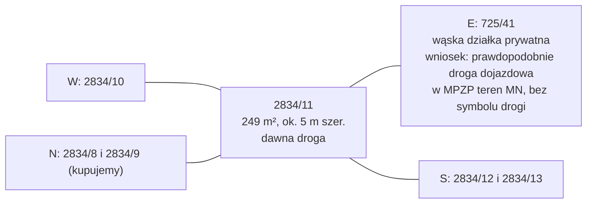

# Działka 2834/11 (Siepraw) — wąski pas, dawna droga

Wąski pas ok. 5 m szerokości wzdłuż południowej granicy 2834/9 i części 2834/8. Sprzedający nazywa go drogą do likwidacji. Sprzedający wiąże odroczenie 50% ceny tej działki (30 627 zł) z wykreśleniem hipoteki eFaktor ([[dzs-oferta-i-mail-z57]]). Wniosek: hipoteka prawdopodobnie obciąża KW KR1Y/00059868/1. Sprawdź dział IV KW.

## Identyfikacja

| Pole | Wartość | Źródło |
|---|---|---|
| Identyfikator TERYT | `120906_2.0003.2834/11` | ULDK GUGiK, `dzs-summary.json` |
| Gmina / obręb | Siepraw / Siepraw (0003), powiat myślenicki, małopolskie | `dzs-summary.json` |
| Księga wieczysta | **KR1Y/00059868/1** (inna niż 2834/8 i 2834/9) | [[dzs-oferta-i-mail-z57]] (tabela xlsx) |
| Grupa rejestrowa EGiB | 15 | KIEG GetFeatureInfo, 2026-10-27 |
| Pow. w ofercie | **249 m²** | [[dzs-oferta-i-mail-z57]] |
| Pow. z geometrii ULDK | 248,6 m² (obwód 113,49 m) | `dzs-summary.json` |
| Użytek | nie ustalono; możliwe „dr” (droga) | — |

> [!question] Do sprawdzenia
> Pobierz wypis z rejestru gruntów. Sprawdź, czy działka ma użytek „dr” (droga). Sprawdź dział III i IV KW KR1Y/00059868/1: hipotekę eFaktor oraz służebności przejazdu dla 2834/10, 2834/12, 2834/13 lub innych działek.

## Cena i płatność

| Pozycja | Wartość | Źródło |
|---|---|---|
| Cena netto za m² | 200 zł/m² | [[dzs-oferta-i-mail-z57]] |
| Cena brutto za m² | 246,00 zł/m² | obliczone z oferty |
| Cena netto | 49 800 zł | [[dzs-oferta-i-mail-z57]] |
| Cena brutto | **61 254 zł** | [[dzs-oferta-i-mail-z57]] |
| Płatne przy akcie | 30 627 zł (50%) | [[dzs-oferta-i-mail-z57]] |
| Odroczone | **30 627 zł (50%)** — po wykreśleniu hipoteki eFaktor, najwcześniej po 1.09.2027 | [[dzs-oferta-i-mail-z57]] |

> [!warning] Hipoteka eFaktor
> Nie kupuj bez zapisu w akcie, kto i do kiedy wykreśla hipotekę eFaktor. Odroczona kwota to zabezpieczenie dla nas. Zapłać ją dopiero po wykreśleniu hipoteki w KW. Szczegóły: [[dzs-transakcja]], [[dzs-ryzyka]].

## Przeznaczenie w MPZP

**Teren 3.22MN** – zabudowa mieszkaniowa jednorodzinna. Plan z 2025 r. **nie ma** na 2834/11 symbolu drogi (KDD/KDW/KR). Cała działka leży w terenie MN. Parametry: [[dzs-mpzp-teren-mn]].

Dowód: georeferowany raster rysunku planu z BIP (https://bip.malopolska.pl/api/files/3859132, EPSG:2178) z dorysowanym obrysem działek z ULDK (`dzs-mpzp-rysunek-dzialki.png`, `dzs-mpzp-rysunek-okolica.png`). Wąski pas 2834/11 leży w jednym pomarańczowym polu MN. Etykieta 3.22MN stoi ok. 90 m na wschód, w tym samym polu, bez białego pasa drogi i bez linii rozgraniczających. Plan ogólny (uchwała XXV/204/26) daje tu strefę 60SJ, co potwierdza funkcję mieszkaniową ([[dzs-dokumenty-i-linki]]).

> [!question] Do sprawdzenia
> Brak symbolu drogi ustalono z rastra planu. Potwierdź wypisem i wyrysem z MPZP. Sprawdź też w dziale III KW, czy na dawnej drodze nie ma służebności przejazdu dla sąsiadów ([[dzs-checklista-przed-zakupem]]).

## Kształt i wymiary

Działka to wąski pas ok. 47 m długości (wschód–zachód). Pas ma ok. 5 m szerokości na całej długości (W: 5,00 m). Bok wschodni przy 725/41 ma 9,21 m, bo obejmuje „hak” w SE narożniku (ok. 2,3 m) i ścięty narożnik 2834/9 (ok. 1,9 m) (dzs-summary.json). Średnia szerokość to ok. 5,3 m (248,6 m² : 46,7 m).

| Bok (punkty ULDK) | Strona | Długość | Sąsiad |
|---|---|---|---|
| P1–P2 + P8–P1 | N (północ) | 14,52 + 32,17 = **46,69 m** | [[dzs-dzialka-2834-8]] (14,52 m), [[dzs-dzialka-2834-9]] (32,17 m) |
| P7–P8 | NE (ścięty narożnik 2834/9) | 3,04 m | [[dzs-dzialka-2834-9]] |
| P6–P7 | E (wschód) — bok wschodni przy 725/41 | **9,21 m** | 725/41 (wąska działka prywatna; wniosek: prawdopodobnie droga dojazdowa; w MPZP teren MN, bez symbolu drogi – `dzs-mpzp-rysunek-dzialki.png`) |
| P5–P6 | SE („hak”) | 2,91 m | 2834/13 |
| P3–P4 + P4–P5 | S (południe) | 25,24 + 21,40 = **46,64 m** | 2834/12 (25,24 m), 2834/13 (21,40 m) |
| P2–P3 | W (zachód) | **5,00 m** | 2834/10 |

Źródło: `dzs-summary.json`, sąsiedzi z ULDK `GetParcelByXY` (https://uldk.gugik.gov.pl/), 2026-10-27.

## Trójkąt w SE narożniku

Sprzedający chce w akcie zobowiązania kupujących do sprzedaży „małego trójkąta w południowo-wschodnim narożniku” za 1 zł. Alternatywa to służebność dla właściciela działki „poniżej”. Cel: wyrównać granicę po likwidacji drogi ([[dzs-oferta-i-mail-z57]]).

Nasza interpretacja geometrii:
- Południowa granica biegnie prosto (azymut 95°) do punktu P5. Potem skręca na SE (P5–P6, 2,91 m) i wraca na północ wzdłuż drogi (P6–P7).
- Część poniżej przedłużenia prostej granicy to trójkąt P5–P6–Q o polu ok. **2,2 m²** (boki ok. 2,1 m). Q to punkt na granicy wschodniej.
- Za bokiem P5–P6 leży działka **2834/13** (ULDK). To prawdopodobnie „działka poniżej” z maila.

> [!question] Do sprawdzenia
> Mail nie podaje pola ani współrzędnych trójkąta. Poproś sprzedającego o szkic geodety z polem i numerem działki, która ma dostać trójkąt. Ustal, kto płaci za podział i notariusza.

## Orientacja i sąsiedzi

## Dostęp do drogi

- Działka graniczy od wschodu z pasem 725/41 na długości 9,21 m.
- 725/41 ma grupę rejestrową 15, więc według EGiB nie należy do gminy ani Skarbu Państwa (potwierdź w KW). Dojazd wymaga służebności. Patrz [[dzs-dzialka-2834-9]] i [[dzs-transakcja]].
- Działka łączy 2834/8 z pasem drogi. To może być potrzebne przy przyszłej sprzedaży 2834/8.

## Teren (NMT 1 m, układ wysokości PL-KRON86-NH)

| Parametr | Wartość | Źródło |
|---|---|---|
| H min / max | 311,91 / 314,58 m (PL-KRON86-NH) | `dzs-summary.json` |
| H średnia | 313,45 m (PL-KRON86-NH) | `dzs-summary.json` |
| Różnica wysokości Δh | **2,67 m** | `dzs-summary.json` |
| Spadek średni | **14,1%** (8,0°) | `dzs-summary.json` |
| Spadek p90 / max | 17,5% / 24,5% | `dzs-summary.json` |
| Ekspozycja | **S** (azymut 199°) | `dzs-summary.json` |
| Najwyższy punkt | wschodni koniec (X 569592,5; Y 227932,5) | `dzs-summary.json` |
| Najniższy punkt | zachodni koniec (X 569543,5; Y 227930,5) | `dzs-summary.json` |

Co to znaczy:
- Wzdłuż: wschodnie ok. 30 m jest prawie płaskie (ok. 313,7–313,9 m). Zachodnie ok. 18 m opada o ok. 1,7 m (do ok. 312,2 m).
- W poprzek: północ → południe Δh 1,04 m na 9,2 m (ok. 11%).

> [!warning] Sprzeczność
> Opisy kierunków profili w `dzs-profile-terenu.png` i `dzs-summary.json` są odwrócone. Profil „E→W” zaczyna się na 312,2 m, czyli na **zachodzie**. Wartości Δh są poprawne.

## Uzbrojenie

- Na działce KIUT nie pokazuje sieci (`dzs-kiut-przeciecia.json`).
- W odległości do 3 m: linia elektroenergetyczna i urządzenia w pasie 725/41 na wschodzie.
- Szczegóły: [[dzs-uzbrojenie-terenu]].

## Rola w planie zakupu i pomysły

- **Poszerzenie ogrodu** domu na [[dzs-dzialka-2834-9]] od południa (ok. 5 m pasa).
- **Wjazd lub dojście** od działki 725/41 do 2834/8 (rezerwa na przyszłość). MPZP dopuszcza w terenach MN komunikację drogową wewnętrzną ([[dzs-mpzp-uchwala]] § 26 ust. 3 pkt 4) i dojazdy niewydzielone (§ 25 ust. 1 pkt 2). Dojazd niewydzielony musi mieć min. 5,0 m szerokości (§ 24 ust. 7). Pas ma na zachodzie dokładnie 5,00 m, a przy 725/41 9,21 m (`dzs-summary.json`). WT wymaga jezdni min. 3 m (§ 14 ust. 1).
- **Pas zieleni izolacyjnej** od działek 2834/12 i 2834/13 (żywopłot).
- **Trasa przyłączy** do domu, jeśli tak wskaże projektant.
- Więcej: [[dzs-pomysly]].

## Mapy

![[dzs-mapa-ewidencja.png]]

![[dzs-mapa-uzbrojenie.png]]

## Weryfikacja

- 2026-10-27: sprawdzono ze źródłami pierwotnymi; poprawiono 3 miejsc (zob. [[dzs-raport-weryfikacji-2026-10-27]]).
- 2026-10-27 (runda 2, spójność i kompletność): sprawdzono ze źródłami pierwotnymi; poprawiono 1 miejsce (zob. [[dzs-raport-weryfikacji-2026-10-27]]).

## Powiązane

- [[dzialki-siepraw]] · [[dzs-mapa-mysli.canvas]]
- [[dzs-dzialka-2834-8]] · [[dzs-dzialka-2834-9]]
- [[dzs-oferta-i-mail-z57]] · [[dzs-transakcja]] · [[dzs-ryzyka]] · [[dzs-checklista-przed-zakupem]]
- [[dzs-dane-gis-i-3d]] · [[dzs-uzbrojenie-terenu]]
- [[dzs-mpzp-teren-mn]] · [[dzs-szybkie-odpowiedzi]] · [[dzs-pomysly]] · [[dzs-harmonogram]]
