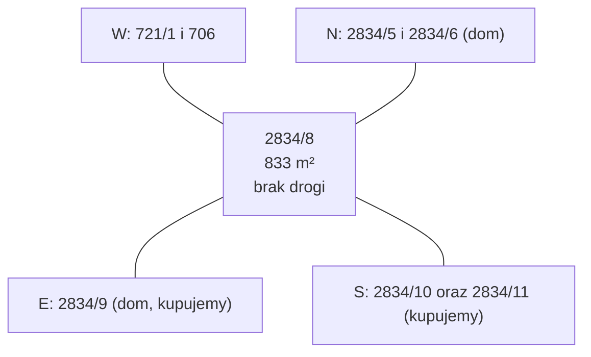

# Działka 2834/8 (Siepraw) — działka zachodnia

Największa z trzech działek, leży na zachód od działki pod dom. Nie ma własnego dostępu do drogi, a przez jej zachodnią część biegnie wodociąg. Strona zbiera dane o działce i pomysły na jej użycie.

## Identyfikacja

| Pole | Wartość | Źródło |
|---|---|---|
| Identyfikator TERYT | `120906_2.0003.2834/8` | ULDK GUGiK, `dzs-summary.json` |
| Gmina / obręb | Siepraw / Siepraw (0003), powiat myślenicki, małopolskie | `dzs-summary.json` |
| Księga wieczysta | KR1Y/00091772/7 (wspólna z [[dzs-dzialka-2834-9]]) | [[dzs-oferta-i-mail-z57]] (tabela xlsx) |
| Grupa rejestrowa EGiB | 15 | KIEG GetFeatureInfo, 2026-10-27 |
| Pow. w ofercie | **833 m²** | [[dzs-oferta-i-mail-z57]] |
| Pow. z geometrii ULDK | 832,4 m² (obwód 118,58 m) | `dzs-summary.json` |
| Użytek / klasa gruntu | nie ustalono (KIEG nie zwrócił danych) | — |

> [!question] Do sprawdzenia
> Pobierz wypis z rejestru gruntów ([[dzs-starostwo-myslenice]]). Sprawdź pole urzędowe, użytek i klasę gruntu.

## Cena

| Pozycja | Wartość | Źródło |
|---|---|---|
| Cena netto za m² | **175 zł/m²** (najtańsza z trzech) | [[dzs-oferta-i-mail-z57]] |
| Cena brutto za m² | 215,25 zł/m² (VAT 23%) | obliczone z oferty |
| Cena netto | 145 775 zł | [[dzs-oferta-i-mail-z57]] |
| Cena brutto | **179 303,25 zł** | [[dzs-oferta-i-mail-z57]] |

Niższa cena za m² może wynikać z braku dostępu do drogi i z wodociągu na działce. To nasz wniosek, nie informacja od sprzedającego.

## Przeznaczenie w MPZP

**Teren 3.22MN** – zabudowa mieszkaniowa jednorodzinna, ten sam teren co [[dzs-dzialka-2834-9]]. Parametry: [[dzs-mpzp-teren-mn]]. Czerwona linia z kwadratami przy zachodniej granicy to wg legendy granica aglomeracji Siepraw (element z przepisów odrębnych, [[dzs-dokumenty-i-linki]]).

Dowód: georeferowany raster rysunku planu z BIP (https://bip.malopolska.pl/api/files/3859132, EPSG:2178) z dorysowanym obrysem działek z ULDK (`dzs-mpzp-rysunek-dzialki.png`, `dzs-mpzp-rysunek-okolica.png`). Działka leży w jednym pomarańczowym polu MN. Etykieta 3.22MN stoi ok. 90 m na wschód, w tym samym polu, bez linii rozgraniczającej. Plan ogólny (uchwała XXV/204/26) daje tu strefę 60SJ, co potwierdza funkcję mieszkaniową ([[dzs-dokumenty-i-linki]]).

> [!question] Do sprawdzenia
> Czerwona linia przerywana z kwadratami przy zachodniej granicy to wg legendy granica aglomeracji Siepraw ([[dzs-mpzp-uchwala]] § 4 ust. 2 pkt 17; § 53 ust. 3 pkt 1: w aglomeracji »obowiązują przepisy odrębne«). Zapytaj w gminie, czy 2834/8 leży wewnątrz aglomeracji i jakie obowiązki z tego wynikają (np. podłączenie do kanalizacji po jej budowie). MPZP dopuszcza też szczelne zbiorniki i przydomowe oczyszczalnie zgodnie z przepisami odrębnymi (§ 53 ust. 3 pkt 4).

## Kształt i wymiary

Działka to prawie prostokąt ok. 36,5 m (wschód–zachód) × 22,7 m (północ–południe). Kilka punktów granicznych leży prawie na jednej linii, dlatego ULDK podaje 7 boków.

| Bok (punkty ULDK) | Strona | Długość | Sąsiad |
|---|---|---|---|
| P2–P3 + P3–P4 | N (północ) | 15,34 + 21,20 = **36,54 m** | 2834/6 (15,34 m, dom), 2834/5 (21,20 m) |
| P1–P2 | E (wschód) | **22,74 m** | [[dzs-dzialka-2834-9]] |
| P6–P7 + P7–P1 | S (południe) | 22,02 + 14,52 = **36,54 m** | 2834/10 (22,02 m), [[dzs-dzialka-2834-11]] (14,52 m) |
| P4–P5 + P5–P6 | W (zachód) | 11,59 + 11,17 = **22,76 m** | 721/1 (11,59 m), 706 (11,17 m) |

Źródło: `dzs-summary.json`, sąsiedzi z ULDK `GetParcelByXY` (https://uldk.gugik.gov.pl/), 2026-10-27.

## Orientacja i sąsiedzi

## Dostęp do drogi

**Działka nie graniczy z żadną drogą (front 0 m).** Dojazd jest możliwy tylko przez [[dzs-dzialka-2834-9]] albo [[dzs-dzialka-2834-11]].

> [!warning] Kupuj tylko razem z 2834/9 lub 2834/11
> Nie kupuj 2834/8 osobno. Bez dojścia i dojazdu do drogi publicznej projekt domu na samej 2834/8 nie spełni WT § 14 ust. 1. Przy późniejszej sprzedaży 2834/8 zapewnij jej dojazd, np. służebnością przejazdu przez 2834/11 lub 2834/9 albo przez sprzedaż razem z 2834/11 (lub jej częścią). Dalej dojazd prowadzi przez prywatną 725/41, więc też wymaga służebności.

## Teren (NMT 1 m, układ wysokości PL-KRON86-NH)

| Parametr | Wartość | Źródło |
|---|---|---|
| H min / max | 310,58 / 316,18 m (PL-KRON86-NH) | `dzs-summary.json` |
| H średnia | 313,65 m (PL-KRON86-NH) | `dzs-summary.json` |
| Różnica wysokości Δh | **5,60 m** (największa z trzech) | `dzs-summary.json` |
| Spadek średni | **16,0%** (9,1°) | `dzs-summary.json` |
| Spadek p90 / max | 20,6% / 30,4% | `dzs-summary.json` |
| Ekspozycja | **SW** (azymut 212°) | `dzs-summary.json` |
| Najwyższy punkt | przy NE narożniku (X 569560,5; Y 227955,5) | `dzs-summary.json` |
| Najniższy punkt | przy SW narożniku (X 569522,5; Y 227937,5) | `dzs-summary.json` |

Wysokości narożników (NMT, PL-KRON86-NH): NE 316,37 m, NW 314,18 m, SW 310,29 m, SE 313,66 m (`dzs-nmt-1m-xyz-epsg2180.csv`).

Co to znaczy:
- Teren opada z NE na SW, czyli w dwóch kierunkach naraz.
- Wzdłuż (wschód → zachód): Δh 2,81 m na 37,9 m (ok. 7%).
- W poprzek (północ → południe): Δh 3,12 m na 23,6 m (ok. 13%).
- To najbardziej strome miejsce z trzech działek. Zabudowa wymaga tarasowania lub murków oporowych.

> [!warning] Sprzeczność
> Opisy kierunków profili w `dzs-profile-terenu.png` i w `dzs-summary.json` (`from_dir`) są odwrócone. Profil „W→E” zaczyna się na 315,04 m, czyli na **wschodzie**. Profil „S→N” zaczyna się na **północy**. Wartości Δh są poprawne.

![[dzs-mapa-rzezba-poziomice.png]]

## Uzbrojenie na działce i w pobliżu

| Sieć | Na działce | Opis | Źródło |
|---|---|---|---|
| Wodociągowa | **tak, ok. 20,5 m** | przewód biegnie ukośnie z N na S przez zachodnią część działki, ok. 7–9 m od zachodniej granicy | `dzs-kiut-przeciecia.json`, `dzs-mapa-uzbrojenie.png` |
| Elektroenergetyczna („eN”, niskie napięcie) | **tak, ok. 65,5 m** | wzdłuż północnej granicy ok. 1 m wewnątrz działki; przy NW narożniku skręca na południe i wychodzi na zachód ok. 12–13 m od NW narożnika; z północy wzdłuż W granicy (ok. 1 m wewnątrz, odczyt z mapy KIUT) dochodzi druga linia | `dzs-kiut-przeciecia.json`, `dzs-mapa-uzbrojenie.png` |
| Urządzenia | ok. 1,2 m | punkt na linii „eN” przy zachodniej granicy | `dzs-kiut-przeciecia.json` |
| Kanalizacyjna | nie | — | `dzs-kiut-przeciecia.json` |
| Gazowa | nie | Najbliżej na SW: gazociąg. Według KIUT ok. 47 m od SW narożnika (dzs-mapa-uzbrojenie.png). Rysunek MPZP pokazuje tu gazociągi wysokiego ciśnienia ze strefą kontrolowaną (legenda: DN 200, DN 300 lub DN 500; element informacyjny, [[dzs-mpzp-uchwala]] § 4 ust. 3 pkt 5; strefy kontrolowane wg § 53 ust. 4 pkt 2). Bliższa linia na rysunku MPZP jest ok. 18 m od SW narożnika (przez 2835/1, 2835/2). Źródła różnią się, więc przebieg potwierdź na mapie do celów projektowych. Wniosek: gazociągu wysokiego ciśnienia nie użyjesz wprost do przyłącza domu. Dostępność gazu sprawdź u PSG. | `dzs-mapa-uzbrojenie.png` (odczyt z rastra), `dzs-mpzp-rysunek-dzialki.png` |

Szczegóły i skutki: [[dzs-uzbrojenie-terenu]].

![[dzs-mapa-uzbrojenie.png]]

> [!warning] Wodociąg przez działkę
> Nie planuj budynku, basenu ani drzew nad wodociągiem. Wzdłuż przewodu zwykle trzeba zachować pas bez zabudowy i bez drzew. Szerokość i warunki podaje gestor sieci ([[dzs-mpzp-uchwala]] § 53 ust. 1 pkt 4 odsyła do przepisów odrębnych). Przełożenie sieci zwykle opłaca zlecający. Zapytaj, czy wodociąg ma służebność przesyłu w KW.

## Istniejące obiekty

Ewidencja nie pokazuje budynków na działce (`dzs-mapa-ewidencja.png`). Ortofotomapa w danych jest pusta, więc pokrycia terenu (drzewa, krzewy) nie sprawdziliśmy. Patrz [[dzs-dane-gis-i-3d]].

## Ograniczenia

- Brak dostępu do drogi (patrz wyżej).
- Wodociąg w zachodniej części: pas bez zabudowy.
- Linia „eN” wzdłuż północnej i części zachodniej granicy.
- Największe spadki z trzech działek (średnio 16%, do 30%).

## Rola w planie zakupu i pomysły

- **Ogród i rekreacja** przy domu na [[dzs-dzialka-2834-9]]: trawnik na tarasach, sad, warzywnik, plac zabaw.
- **Bufor prywatności** od zachodu i od domu na 2834/6.
- **Retencja wody deszczowej** w najniższym, SW narożniku (staw, ogród deszczowy, zbiornik). Sprawdź warunki gruntowe: [[dzs-warunki-gruntowe]].
- **Rezerwa na przyszłość:** drugi budynek albo sprzedaż. Wymaga dojazdu przez 2834/11 i analizy MPZP. Przy nowym podziale w terenie 3.1-26MN MPZP wymaga dla nowej działki budowlanej min. 600 m² i frontu min. 16,0 m ([[dzs-mpzp-uchwala]] § 24 ust. 5 pkt 1). Parametry można obniżyć o 10% tylko wtedy, gdy wielkość dzielonej działki nie pozwala ich zachować (§ 24 ust. 6). Dojazd niewydzielony musi mieć min. 5,0 m szerokości (§ 24 ust. 7). WT wymaga jezdni dojazdu min. 3 m (§ 14 ust. 1). 2834/11 ma na zachodzie dokładnie 5,00 m, a jej bok przy 725/41 ma 9,21 m (`dzs-summary.json`). 2834/8 już istnieje. Zapytaj projektanta, które z tych warunków mają zastosowanie.
- **Panele PV na gruncie** od strony południowej, jeśli MPZP pozwala.
- Więcej: [[dzs-pomysly]].

## Mapy

![[dzs-mapa-ewidencja.png]]

![[dzs-mapa-spadki.png]]

## Weryfikacja

- 2026-10-27: sprawdzono ze źródłami pierwotnymi; poprawiono 5 miejsc (zob. [[dzs-raport-weryfikacji-2026-10-27]]).
- 2026-10-27 (runda 2, spójność i kompletność): sprawdzono ze źródłami pierwotnymi; poprawiono 1 miejsce (zob. [[dzs-raport-weryfikacji-2026-10-27]]).

## Powiązane

- [[dzialki-siepraw]] · [[dzs-mapa-mysli.canvas]]
- [[dzs-dzialka-2834-9]] · [[dzs-dzialka-2834-11]]
- [[dzs-dane-gis-i-3d]] · [[dzs-uzbrojenie-terenu]] · [[dzs-dostawcy-mediow]]
- [[dzs-oferta-i-mail-z57]] · [[dzs-ryzyka]] · [[dzs-pomysly]]
- [[dzs-mpzp-teren-mn]] · [[dzs-szybkie-odpowiedzi]] · [[dzs-transakcja]] · [[dzs-checklista-przed-zakupem]]
