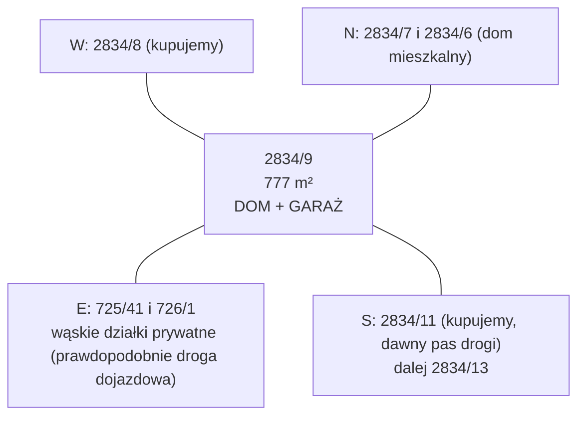

# Działka 2834/9 (Siepraw) — działka pod dom

Główna działka zakupu. Na niej planujemy dom jednorodzinny z garażem. Strona zbiera wszystkie dane o działce: identyfikację, cenę, kształt, sąsiadów, teren, sieci i ograniczenia.

## Identyfikacja

| Pole | Wartość | Źródło |
|---|---|---|
| Identyfikator TERYT | `120906_2.0003.2834/9` | ULDK GUGiK, `dzs-summary.json` |
| Gmina / obręb | Siepraw / Siepraw (0003), powiat myślenicki, małopolskie | `dzs-summary.json` |
| Księga wieczysta | KR1Y/00091772/7 (wspólna z [[dzs-dzialka-2834-8]]) | [[dzs-oferta-i-mail-z57]] (tabela xlsx) |
| Grupa rejestrowa EGiB | 15 (ta sama co sprzedający, spółka) | KIEG GetFeatureInfo, 2026-10-27 |
| Pow. w ofercie | **777 m²** | [[dzs-oferta-i-mail-z57]] |
| Pow. z geometrii ULDK | 775,8 m² (obwód 112,76 m) | `dzs-summary.json` |
| Użytek / klasa gruntu | nie ustalono (KIEG nie zwrócił danych) | — |

Różnica między ofertą (777 m²) a geometrią ULDK (775,8 m²) to 1,2 m² (0,15%), czyli mało. Pole urzędowe z EGiB potwierdź wypisem z rejestru gruntów.

> [!question] Do sprawdzenia
> Usługa KIEG zwróciła puste pole „Pole pow. w ewidencji (ha)” i puste „Oznaczenie użytku”. Pobierz wypis z rejestru gruntów ([[dzs-starostwo-myslenice]]). Sprawdź użytek i klasę gruntu. Klasa I–III na gruncie mineralnym może wymagać wyłączenia z produkcji rolnej (koszt). Na rysunku MPZP w sąsiedztwie widać oznaczenia „PsIII” (`dzs-mpzp-rysunek-dzialki.png`).

## Cena

| Pozycja | Wartość | Źródło |
|---|---|---|
| Cena netto za m² | 200 zł/m² | [[dzs-oferta-i-mail-z57]] |
| Cena brutto za m² | 246,00 zł/m² (VAT 23%) | obliczone z oferty |
| Cena netto | 155 400 zł | [[dzs-oferta-i-mail-z57]] |
| Cena brutto | **191 142 zł** | [[dzs-oferta-i-mail-z57]] |

Szczegóły płatności (401 072 zł przy akcie, 30 627 zł odroczone) opisuje [[dzs-transakcja]].

## Przeznaczenie w MPZP

**Teren 3.22MN** – zabudowa mieszkaniowa jednorodzinna. Parametry: [[dzs-mpzp-teren-mn]] (intensywność max 0,40 – grupa 3.1-24MN, §26 ust. 4 pkt 1 lit. b; PBC min 40% i zabudowa max 40% – grupa 3.1-26MN, §26 ust. 4 pkt 3–4 lit. a; min. nowa działka 600 m² – grupa 3.1-26MN, §24 ust. 5 pkt 1 lit. a). Linii zabudowy przy działce na rysunku brak. Szybkie liczby: [[dzs-szybkie-odpowiedzi]].

Dowód: georeferowany raster rysunku planu z BIP (https://bip.malopolska.pl/api/files/3859132, EPSG:2178) z dorysowanym obrysem działek z ULDK (`dzs-mpzp-rysunek-dzialki.png`, `dzs-mpzp-rysunek-okolica.png`). Działka leży w jednym pomarańczowym polu MN. Etykieta 3.22MN stoi ok. 90 m na wschód, w tym samym polu, bez linii rozgraniczającej. Plan ogólny (uchwała XXV/204/26) daje tu strefę 60SJ, co potwierdza funkcję mieszkaniową ([[dzs-dokumenty-i-linki]]).

![[dzs-mpzp-rysunek-dzialki.png]]

> [!question] Do sprawdzenia
> Symbol 3.22MN ustalono z rastra planu, nie z urzędowego dokumentu. Potwierdź go wypisem i wyrysem z MPZP ([[dzs-urzad-gminy-siepraw]], [[dzs-checklista-przed-zakupem]]).

## Kształt i wymiary

Działka to prawie prostokąt ok. 34 m (wschód–zachód) × 22,7 m (północ–południe). Dłuższa oś jest obrócona o ok. 5° od linii wschód–zachód. Południowo-wschodni narożnik jest ścięty (3,04 m).

| Bok (punkty ULDK) | Strona | Długość | Sąsiad |
|---|---|---|---|
| P7–P1 + P1–P2 | N (północ) | 24,47 + 9,71 = **34,18 m** | 2834/7 (24,47 m), 2834/6 (9,71 m, z domem) |
| P5–P6 + P6–P7 | E (wschód) — **front do drogi** | 7,78 + 12,85 = **20,63 m** | 725/41 (wąska działka prywatna ok. 4,9 m; wniosek: prawdopodobnie używana jako droga dojazdowa; na rysunku MPZP leży w terenie MN, bez symbolu drogi KDD/KR – `dzs-mpzp-rysunek-dzialki.png`; użytek w EGiB nie ustalony) |
| P4–P5 | SE (ścięty narożnik) | 3,04 m | [[dzs-dzialka-2834-11]] |
| P3–P4 | S (południe) | **32,17 m** | [[dzs-dzialka-2834-11]] |
| P2–P3 | W (zachód) | **22,74 m** | [[dzs-dzialka-2834-8]] |

Źródło: `dzs-summary.json` (boki, `ring`), sąsiedzi z ULDK `GetParcelByXY` (https://uldk.gugik.gov.pl/), 2026-10-27. Współrzędne narożników są w [[dzs-dane-gis-i-3d]].

## Orientacja i sąsiedzi

- Północ: działka 2834/6 z budynkiem mieszkalnym „m” oraz 2834/7 (`dzs-mapa-ewidencja.png`).
- Wschód: wąskie działki 725/41 (ok. 4,9 m) i 726/1 (ok. 3,3 m). Razem tworzą pas ok. 8 m wzdłuż osi N–S (geometria ULDK, 2026-10-27).
- Południe i zachód: działki, które kupujemy razem z tą.

## Dostęp do drogi

- Działka graniczy od wschodu z działką 725/41 na długości ok. 20,6 m.
- 725/41 i 726/1 mają w EGiB grupę rejestrową 15, tak jak działki sprzedającego (KIEG GetFeatureInfo, 2026-10-27). Według grupy 15 właścicielem nie jest gmina ani Skarb Państwa. Potwierdź to w KW działek drogowych.
- Sprzedający obiecuje „służebności do wszystkich głównych dróg dojazdowych” przy akcie ([[dzs-oferta-i-mail-z57]]).

> [!warning] Dojazd przez prywatne działki
> Dojazd prowadzi przez działki prywatne. Bez wpisanej służebności drogi nie masz prawa przejazdu. Nie podpisuj aktu bez służebności do drogi publicznej. Szczegóły: [[dzs-transakcja]], [[dzs-ryzyka]].

> [!question] Do sprawdzenia
> Nie ustaliliśmy, gdzie pas 725/41 / 726/1 dochodzi do drogi publicznej. Na północnym końcu sąsiadują działki 725/12 i 727/12 (grupa 7, osoby fizyczne), a na południowym 1489 (grupa 7). Poproś o mapę z przebiegiem wszystkich służebności i o numery KW działek drogowych. Sprawdź użytek 725/41 i 726/1 (np. „dr”) w wypisie z rejestru gruntów.

## Teren (NMT 1 m, układ wysokości PL-KRON86-NH)

| Parametr | Wartość | Źródło |
|---|---|---|
| H min / max | 313,71 / 317,02 m (PL-KRON86-NH) | `dzs-summary.json` |
| H średnia | 315,47 m (PL-KRON86-NH) | `dzs-summary.json` |
| Różnica wysokości Δh | **3,31 m** | `dzs-summary.json` |
| Spadek średni | **12,9%** (7,3°) | `dzs-summary.json` |
| Spadek p90 / max | 16,5% / 25,1% | `dzs-summary.json` |
| Ekspozycja (kierunek spadku) | **S** (azymut 194°, czyli lekko na SSW) | `dzs-summary.json` |
| Najwyższy punkt | NE narożnik (X 569591,5; Y 227953,5) | `dzs-summary.json` |
| Najniższy punkt | SW narożnik (X 569558,5; Y 227934,5) | `dzs-summary.json` |

Wysokości narożników (NMT, PL-KRON86-NH): NE 317,17 m, NW 316,37 m, SW 313,66 m, SE 314,18–314,58 m (`dzs-nmt-1m-xyz-epsg2180.csv`).

Co to znaczy:
- Kierunek wschód–zachód jest prawie płaski: Δh 0,58 m na 37,3 m (profil wzdłuż). W linii środka działki teren rośnie z ok. 314,8 m (W) do ok. 315,9 m (E), czyli ok. 3% (`dzs-nmt-1m-xyz-epsg2180.csv`).
- Kierunek północ–południe opada ok. **2,5–2,6 m na ok. 22 m** szerokości działki (ok. 11–12%, `dzs-nmt-1m-xyz-epsg2180.csv`, PL-KRON86-NH). Profil »w poprzek« z `dzs-summary.json` ma 30 m i biegnie po skosie od NE do SW narożnika (Δh 3,41 m).
- Dom o głębokości 10–12 m (N–S) ma pod sobą ok. 1,1–1,4 m różnicy terenu. Projektant wybierze np. podpiwniczenie częściowe, półpoziomy albo taras od południa.
- Przy wschodniej granicy NMT pokazuje niski próg ok. 0,2–0,4 m. Pas drogi 725/41 leży na południu działki ok. 0,2–0,5 m niżej niż działka (`dzs-nmt-1m-xyz-epsg2180.csv`, próbki co 1 m).

> [!warning] Sprzeczność
> Opisy kierunków w `dzs-profile-terenu.png` i w polu `from_dir` w `dzs-summary.json` są odwrócone. Profil „w poprzek (S→N)” zaczyna się na 317,09 m, czyli na **północy**. Narożniki północne mają 316,4–317,2 m, a południowe 313,7–314,6 m. Teren opada z północy na południe. Wartości Δh są poprawne.

![[dzs-profile-terenu.png]]

![[dzs-mapa-rzezba-poziomice.png]]

![[dzs-mapa-spadki.png]]

> [!question] Do sprawdzenia
> NMT ma błąd ok. ±0,15–0,3 m i nie pokazuje nasypów z ostatnich lat. Projekt wymaga mapy do celów projektowych w układzie PL-EVRF2007-NH. Różnicę układów uwzględnia geodeta. Warunki gruntowe: [[dzs-warunki-gruntowe]], [[dzs-opinia-geotechniczna]].

## Uzbrojenie na działce i w pobliżu

Dane z KIUT (GESUT), zrzut WMS 4 px/m. Długości są przybliżone (`dzs-kiut-przeciecia.json`).

| Sieć | Na działce | Opis | Źródło |
|---|---|---|---|
| Elektroenergetyczna (oznaczenie „eN”, niskie napięcie) | **tak, ok. 41 m** | biegnie wzdłuż północnej granicy, ok. 1 m wewnątrz działki; w NE narożniku skupisko punktów „e” (prawdopodobnie złącze lub słup) | `dzs-mapa-uzbrojenie.png`, `dzs-kiut-przeciecia.json` |
| Kanalizacyjna | **tak, ok. 20 m** | przewód wchodzi z północy ok. 4 m od NE narożnika i biegnie na południe do małego obiektu ok. 2,5 × 2,5 m | `dzs-mapa-uzbrojenie.png`, `dzs-kiut-przeciecia.json` |
| Urządzenia (`przewod_urzadzenia`) | tak, ok. 18 m | to samo miejsce co kanalizacja i obiekt przy E granicy | `dzs-kiut-przeciecia.json` |
| Wodociągowa | nie | najbliżej na [[dzs-dzialka-2834-8]] (ok. 25–30 m na zachód) | `dzs-kiut-przeciecia.json` |
| Gazowa | nie | Najbliżej na SW: gazociąg. Według KIUT ok. 47 m od SW narożnika [[dzs-dzialka-2834-8]] (dzs-mapa-uzbrojenie.png). Rysunek MPZP pokazuje tu gazociągi wysokiego ciśnienia ze strefą kontrolowaną (legenda: DN 200, DN 300 lub DN 500; element informacyjny, [[dzs-mpzp-uchwala]] § 4 ust. 3 pkt 5; strefy kontrolowane wg § 53 ust. 4 pkt 2). Bliższa linia na rysunku MPZP jest ok. 18 m od SW narożnika [[dzs-dzialka-2834-8]] (przez 2835/1, 2835/2). Źródła różnią się, więc przebieg potwierdź na mapie do celów projektowych. Wniosek: gazociągu wysokiego ciśnienia nie użyjesz wprost do przyłącza domu. Dostępność gazu sprawdź u PSG. | `dzs-mapa-uzbrojenie.png`, `dzs-mpzp-rysunek-dzialki.png` |
| Telekomunikacyjna | brak w zasięgu mapy | — | `dzs-kiut-przeciecia.json` |

Pełny opis i skutki dla budowy: [[dzs-uzbrojenie-terenu]].

![[dzs-mapa-uzbrojenie.png]]

## Istniejące obiekty — szambo

- Mały kwadratowy obiekt ok. 2,5 × 2,5 m leży ok. 3–4 m od wschodniej granicy i ok. 4–5 m od południowej granicy (X ≈ 569589, Y ≈ 227936, odczyt z `dzs-mapa-uzbrojenie.png`).
- Do obiektu dochodzi przewód kanalizacyjny z północy. Przewód zaczyna się przy budynku „m” na 2834/6 i biegnie przez 2834/7.
- Mail ([[dzs-oferta-i-mail-z57]]): »W umowie zawrzemy konkretne zobowiązania dotyczące terminowej budowy sieci kanalizacyjnej i wodociągowej, a także w zakresie likwidacji istniejącego szamba -> obecnie nie ma służebności. Zapiszemy więc prawo do jego likwidacji po określonej dacie.« Mail nie mówi, kto ma zlikwidować szambo i na czyj koszt, ani czyje jest »prawo do likwidacji«. Ustal to w akcie. Ustal też termin i zakres zobowiązań dotyczących kanalizacji i wodociągu.

> [!warning] Cudze szambo na naszej działce
> Na działce prawdopodobnie stoi szambo sąsiada. Nie kupuj bez zapisu w akcie: kto likwiduje szambo i przewód, do kiedy, na czyj koszt i z jaką karą umowną. Zakaz nowej służebności dla sąsiada też wpisz do aktu. Szczegóły: [[dzs-transakcja]], [[dzs-ryzyka]].

> [!question] Do sprawdzenia
> Czyj dom korzysta z szamba? Mapa wskazuje na dom na 2834/6, ale to wniosek z rysunku. Zapytaj sprzedającego i sprawdź na mapie do celów projektowych.

## Ograniczenia dla zabudowy

- Linia „eN” wzdłuż północnej granicy leży w pasie, w którym i tak zwykle nie stawia się budynku (odległości od granicy: [[dzs-warunki-techniczne-odleglosci]]). Sprawdź, czy to kabel w ziemi czy linia napowietrzna.
- Przewód kanalizacyjny i szambo zajmują pas przy wschodniej granicy. Do czasu likwidacji ograniczają wjazd i garaż od strony drogi.
- Sieci obcego właściciela na działce to zwykle służebność przesyłu albo jej brak (do uregulowania). Patrz [[dzs-uzbrojenie-terenu]].
- Linie zabudowy, wysokość, dach, intensywność: [[dzs-mpzp-teren-mn]], [[dzs-szybkie-odpowiedzi]].

## Rola w planie zakupu

- **Działka budowlana:** dom jednorodzinny z garażem ([[dzs-planer-dzialki-dom]]).
- Wjazd od wschodu przez 725/41 (wymaga służebności). Front ma ok. 20,6 m.
- Wyższa część (N, NE) jest blisko drogi i złącza „e”. Garaż przy NE narożniku skraca podjazd i przyłącze prądu.
- Ogród od południa ma dobre nasłonecznienie, bo teren opada na S. Ogród może przejść na [[dzs-dzialka-2834-11]] i [[dzs-dzialka-2834-8]].
- Pomysły: [[dzs-pomysly]].

> [!question] Do sprawdzenia
> Czy wspólna własność 2834/8, 2834/9 i 2834/11 pozwala traktować je jak jedną działkę budowlaną przy odległościach od granic? Zapytaj projektanta. Rozważ połączenie działek przez geodetę (2834/8 i 2834/9 są już w jednej KW).

## Mapy

![[dzs-mapa-ewidencja.png]]

![[dzs-widok-3d-teren.png]]

## Weryfikacja

- 2026-10-27: sprawdzono ze źródłami pierwotnymi; poprawiono 5 miejsc (zob. [[dzs-raport-weryfikacji-2026-10-27]]).
- 2026-10-27 (runda 2, spójność i kompletność): sprawdzono ze źródłami pierwotnymi; poprawiono 1 miejsce (zob. [[dzs-raport-weryfikacji-2026-10-27]]).

## Powiązane

- [[dzialki-siepraw]] · [[dzs-mapa-mysli.canvas]]
- [[dzs-dzialka-2834-8]] · [[dzs-dzialka-2834-11]]
- [[dzs-dane-gis-i-3d]] · [[dzs-uzbrojenie-terenu]] · [[dzs-warunki-gruntowe]]
- [[dzs-oferta-i-mail-z57]] · [[dzs-transakcja]] · [[dzs-ryzyka]] · [[dzs-checklista-przed-zakupem]]
- [[dzs-mpzp-teren-mn]] · [[dzs-warunki-techniczne-odleglosci]] · [[dzs-planer-dzialki-dom]]
- [[dzs-szybkie-odpowiedzi]] · [[dzs-pomysly]] · [[dzs-harmonogram]] · [[dzs-slownik]]
