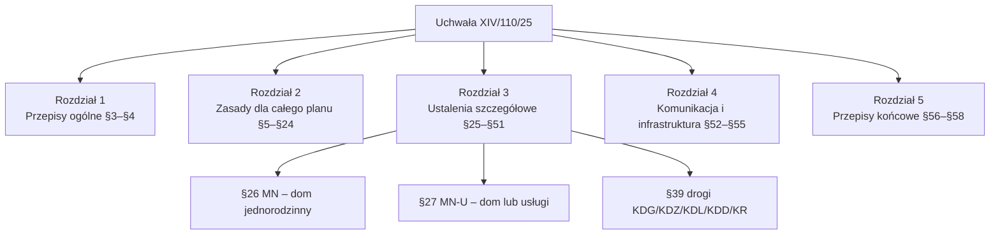

# Uchwała Nr XIV/110/25 – MPZP Siepraw, obszar A

To jest miejscowy plan zagospodarowania przestrzennego (MPZP) dla wsi Siepraw, Zakliczyn, Czechówka i Łyczanka – obszar A. Rada Gminy Siepraw uchwaliła go 2 lipca 2025 r. Plan mówi, co i jak wolno zbudować na naszych działkach 2834/8, 2834/9 i 2834/11.

- Plik PDF (oryginał z podpisem): ![[dzs-mpzp-uchwala-XIV-110-25.pdf]]
- Rysunek planu (załącznik nr 1): ![[dzs-mpzp-zalacznik1-rysunek.pdf]]
- Tekst do przeszukiwania: `raw/dzialki-siepraw/documents/dzs-mpzp-uchwala-XIV-110-25.txt`
- Granica planu (dane przestrzenne, GML): `raw/dzialki-siepraw/documents/dzs-mpzp-granica-planu.gml`

## Metryka

| Pole | Wartość | Źródło |
|---|---|---|
| Numer | XIV/110/25 | s. 1 |
| Organ | Rada Gminy Siepraw | s. 1 |
| Data uchwalenia | 2 lipca 2025 r. | s. 1 |
| Obszar | wsie Siepraw, Zakliczyn, Czechówka, Łyczanka – obszar A, ok. 3140 ha | §1 ust. 1–2 |
| Skala rysunku | 1:2000 | §2 ust. 1 pkt 2 |
| Wejście w życie | 14 dni od ogłoszenia w Dzienniku Urzędowym Województwa Małopolskiego | §58 |
| Ogłoszenie / wejście w życie | ogłoszona w Dz. Urz. Woj. Małopolskiego z 16 lipca 2025 r., poz. 4532; plan obowiązuje od 31 lipca 2025 r. | https://edziennik.malopolska.uw.gov.pl/WDU_K/2025/4532/akt.pdf, §58 |
| Stawka renty planistycznej | 20% dla wszystkich terenów | §56 |
| Id dokumentu elektronicznego | ACFF19ED-342A-4CFB-AA78-E4801B7970E8 | stopka każdej strony |

> [!info] Ogłoszenie i renta planistyczna
> Uchwała ogłoszona w Dz. Urz. Woj. Małopolskiego z 16 lipca 2025 r., poz. 4532 (źródło pierwotne: https://edziennik.malopolska.uw.gov.pl/WDU_K/2025/4532/akt.pdf). Plan obowiązuje od 31 lipca 2025 r. (§58). Termin 5 lat na opłatę planistyczną (upzp art. 37 ust. 3–4, t.j. Dz.U. 2026 poz. 538) mija około 31 lipca 2030 r. Sprzedaż w listopadzie 2026 r. jest w tym terminie.
>
> Opłata planistyczna wynosi 20% wzrostu wartości działki (§56). Wójt ustala ją decyzją po otrzymaniu wypisu aktu notarialnego (upzp art. 37 ust. 5–6) i pobiera od **zbywającego** (sprzedającego). Należy się tylko wtedy, gdy wartość wzrosła w związku z uchwaleniem planu i gdy sprzedaż następuje w ciągu 5 lat od dnia, w którym plan zaczął obowiązywać (upzp art. 36 ust. 4, art. 37 ust. 1, 3, 4). Wzrost wartości ustala się na dzień sprzedaży.

## Z czego składa się plan

| Część | Co zawiera | Czy wiąże? | Gdzie w PDF |
|---|---|---|---|
| Tekst uchwały | §1–§58 | tak – ustalenia planu | s. 1–40 |
| Załącznik nr 1 – Rysunek planu 1:2000 | linie rozgraniczające, symbole terenów, linie zabudowy, strefy | tak – ustalenia planu (§2 ust. 1 pkt 2) | s. 41–45 głównego PDF (arkusze wielkoformatowe; w txt puste) oraz osobny plik ![[dzs-mpzp-zalacznik1-rysunek.pdf]] |
| Załącznik nr 2 | rozstrzygnięcie o uwagach z konsultacji społecznych (tabela ok. 165 uwag) | nie (§2 ust. 2 pkt 1) | s. 46–58 |
| Załącznik nr 3 | finansowanie infrastruktury technicznej gminy | nie (§2 ust. 2 pkt 2) | s. 59 |
| Załącznik nr 4 | dane przestrzenne (GML) | nie (§2 ust. 2 pkt 3) | s. 60 |

W załączniku nr 2 nie ma uwag dotyczących działek 2834/x (przeszukano tekst pod kątem „2834”).

## Struktura tekstu – co gdzie jest

| Rozdział / § | Temat | Strona wiki |
|---|---|---|
| §1–§2 | zakres planu, części planu | ta strona |
| §3 | definicje (dach płaski, front działki, linia zabudowy, wskaźniki) | [[dzs-mpzp-definicje]] |
| §4 | oznaczenia na rysunku, symbole terenów, zasada numeracji | [[dzs-mpzp-definicje]] |
| §5–§15 | środowisko, hałas, ppoż., cieki i rowy, ujęcia wody, cmentarze, osuwiska (SOPO), pomniki przyrody, lasy ochronne | [[dzs-mpzp-ustalenia-ogolne]] |
| §16–§18 | zabytki rejestrowe, gminna ewidencja zabytków, stanowiska archeologiczne | [[dzs-mpzp-ustalenia-ogolne]] |
| §19–§21 | zasady ogólne, przestrzenie publiczne, istniejące budynki | [[dzs-mpzp-ustalenia-ogolne]] |
| §22–§23 | linie zabudowy, budynek 1,5 m od granicy / w granicy (front < 16 m), odległość od lasu | [[dzs-mpzp-ustalenia-ogolne]] |
| §24 | scalenia i podziały, minimalna działka, front, kąt granic | [[dzs-mpzp-ustalenia-ogolne]], [[dzs-mpzp-teren-mn]] |
| §25 | co wolno w każdym terenie MN/MN-U (garaże, wiaty, parkingi), kolory | [[dzs-mpzp-ustalenia-ogolne]] |
| §26 | tereny MN | [[dzs-mpzp-teren-mn]] |
| §27 | tereny MN-U | [[dzs-mpzp-teren-mn-u]] |
| §28–§38 | tereny usług, sportu, produkcji (U, UE, UR, UB-UA, UT-US, UT-US-ZN, US, U-PP-PS, PP-PS) | [[dzs-mpzp-ustalenia-ogolne]] (tabela „tereny sąsiednie”) |
| §39 | drogi publiczne i wewnętrzne | [[dzs-mpzp-infrastruktura-i-komunikacja]] |
| §40–§51 | KO, KO-INS, IG/IW/IKP, IKO, RN, RZ, RA, WS, L, ZN, ZP, C | [[dzs-mpzp-ustalenia-ogolne]] |
| §52–§55 | komunikacja, parkingi, woda, ścieki, deszczówka, gaz, ciepło, prąd, telekom, odpady, OZE | [[dzs-mpzp-infrastruktura-i-komunikacja]] |
| §56–§58 | renta planistyczna 20%, wykonanie, wejście w życie | ta strona |

## Jak czytać plan dla naszej działki – krok po kroku

1. Znajdź działkę na rysunku (załącznik nr 1) albo w portalu https://siepraw.e-mpzp.pl/.
2. Odczytaj symbol terenu, np. `3.120MN`. Pierwsza cyfra to miejscowość: 3 = Siepraw (§4 ust. 4 pkt 2 lit. a). Liczba po kropce to numer terenu. Litery to przeznaczenie. Ta zasada dotyczy tylko terenów spoza listy w §4 ust. 4 pkt 1. Tereny KDG, KDZ, KDL, KDD, KR, RN, RA, WS, L i ZN mają tylko numer (ciągły dla całego planu w danym przeznaczeniu) i litery, bez cyfry miejscowości i kropki, np. 86RN na zachód od 2834/8 (§4 ust. 4 pkt 1).
3. Otwórz paragraf dla tych liter: MN → §26, MN-U → §27.
4. Sprawdź, w której grupie symboli jest Twój numer. Wskaźniki w §26 zależą od numeru terenu.
5. Odczytaj z rysunku: nieprzekraczalną linię zabudowy (§22), strefy (osuwiska §12, cmentarz §11, ujęcia wody §9), granicę aglomeracji (§53 ust. 3 pkt 1).
6. Dodaj zasady ogólne (§5–§25) i infrastrukturę (§52–§55).
7. Dodaj przepisy ogólne (warunki techniczne, Prawo budowlane). Patrz [[dzs-warunki-techniczne-odleglosci]].

> [!question] Do sprawdzenia
> Ta strona nie ustala symbolu terenu dla działek 2834/8, 2834/9, 2834/11. Symbol ustala strona działki: [[dzs-dzialka-2834-9]], [[dzs-dzialka-2834-8]], [[dzs-dzialka-2834-11]]. Rysunek planu to PDF bez georeferencji (`raw/.../2026-10-27-zalozenia-kupujacych.md`). Najpewniej: wypis i wyrys z MPZP z Urzędu Gminy ([[dzs-urzad-gminy-siepraw]]).

## Elementy rysunku planu (§4)

| Rodzaj | Elementy | §4 |
|---|---|---|
| Obowiązujące ustalenia | granica planu, linie rozgraniczające, nieprzekraczalne linie zabudowy od dróg, strefa hałasu od 1KDG, symbole terenów | ust. 1 |
| Z przepisów odrębnych | strefy ujęć wody (Skawinka, Zbiornik Dobczycki), zbiornik „Pasternik”, strefy 50 m i 150 m od cmentarzy, osuwiska (SOPO i uchwała z 2010 r.), pomniki przyrody, lasy ochronne, stanowiska archeologiczne, zabytki, granice aglomeracji Siepraw i Dobczyce Centrum | ust. 2 |
| Tylko informacyjne | ciągi i punkty widokowe, rurociągi ZUW Raba ø1000/ø1400, linia 110 kV ze strefą, gazociągi wysokiego ciśnienia DN200/300/500 ze strefą, granice wsi i gminy | ust. 3 |

## Błędy redakcyjne w tekście uchwały

> [!warning] Sprzeczność
> W tekście są niepełne odesłania i luka w numeracji. Cytujemy je dosłownie:
> - §22 ust. 2: „…należy stosować ustalenia określone w .” – brak numeru paragrafu (prawdopodobnie chodzi o §21 ust. 4 pkt 2, ale to tylko nasze przypuszczenie).
> - §53 ust. 5: „…z zastrzeżeniem ograniczeń wynikających w .” – brak odesłania.
> - §53 ust. 3 pkt 6: „w obszarach, o których mowa w i §12” – zbędne „w i”.
> - §27 ma ust. 1–5 i ust. 7; nie ma ust. 6. Cytujemy „§27 ust. 7” tak, jak w tekście.
> Te błędy nie zmieniają liczb dla domu. Przy sporze interpretacyjnym zapytaj urząd gminy.

## Podstawa prawna planu

Plan uchwalono na podstawie ustawy o planowaniu i zagospodarowaniu przestrzennym (t.j. Dz.U. 2024 poz. 1130) w związku z art. 67 ust. 4 pkt 1 ustawy z 7 lipca 2023 r. (Dz.U. 2023 poz. 1688) – czyli na „starych” zasadach procedury (s. 1). Definicje wskaźników (§3 pkt 10, 20–22) odsyłają do tej ustawy. Aktualny tekst jednolity ustawy: Dz.U. 2026 poz. 538 (plik `dzs-upzp-dz-u-2026-538-tj.pdf`, https://isap.sejm.gov.pl/isap.nsf/DocDetails.xsp?id=WDU20260000538).

## Weryfikacja

- 2026-10-27: sprawdzono ze źródłami pierwotnymi; poprawiono 6 miejsc (zob. [[dzs-raport-weryfikacji-2026-10-27]]).

## Powiązane

- [[dzialki-siepraw]] – hub sekcji
- [[dzs-mpzp-definicje]] · [[dzs-mpzp-ustalenia-ogolne]] · [[dzs-mpzp-teren-mn]] · [[dzs-mpzp-teren-mn-u]] · [[dzs-mpzp-infrastruktura-i-komunikacja]]
- [[dzs-warunki-techniczne-odleglosci]] · [[dzs-szybkie-odpowiedzi]] · [[dzs-dokumenty-i-linki]]
- [[dzs-koszty-zakupu-i-podatki]] (renta planistyczna §56)
- [[dzs-slownik]] · [[dzs-pomysly]]
