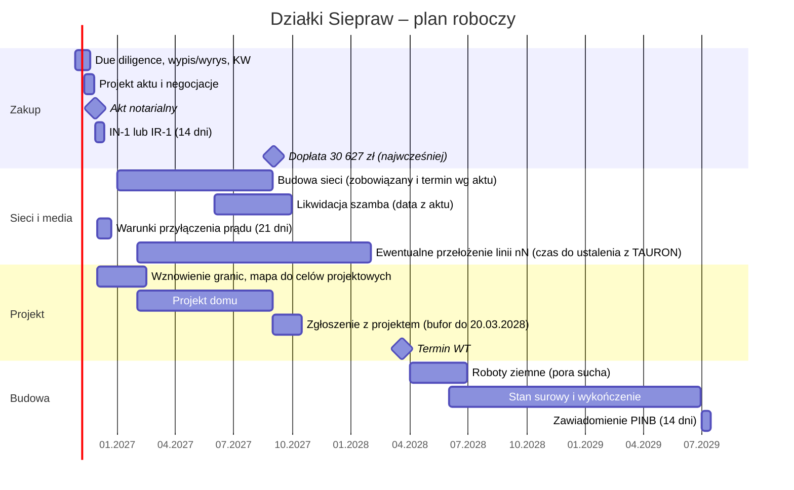
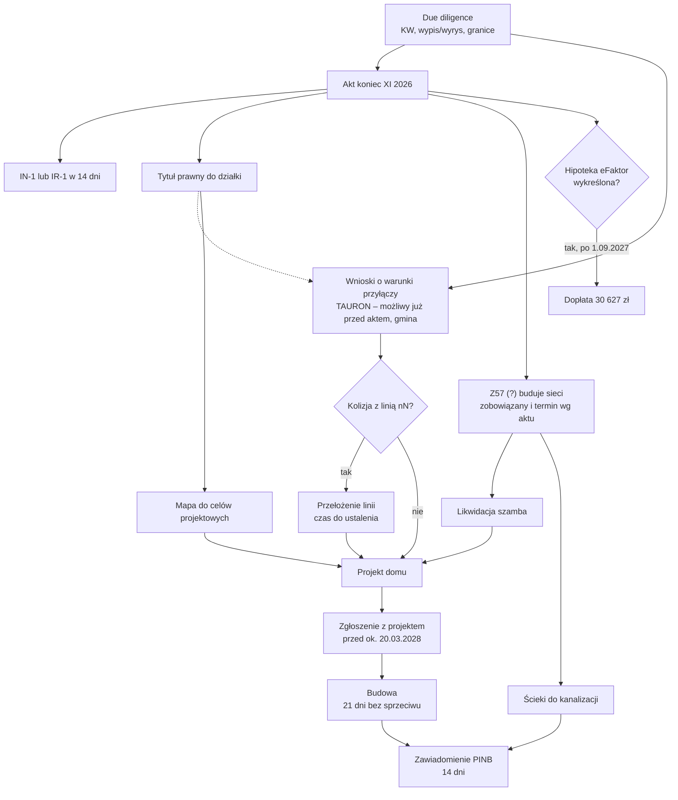

# Harmonogram – od dziś do zamieszkania

Oś czasu od 27.10.2026 do budowy domu. Strona pokazuje twarde terminy, terminy z przepisów i zależności między krokami. Daty bez źródła to nasz plan roboczy.

## Twarde terminy

| Data | Zdarzenie | Źródło |
|---|---|---|
| 27.10.2026 | Dziś – start due diligence | – |
| koniec XI 2026 | Akt notarialny, płatność 401 072 zł | [[dzs-oferta-i-mail-z57]], warunek 3 (nasza numeracja) |
| akt + 14 dni | IN-1 albo IR-1 (zależnie od użytku w EGiB) do UG Siepraw | [[dzs-urzad-gminy-siepraw]] |
| po 1.09.2027 (najwcześniej) | Dopłata 30 627 zł po wykreśleniu hipoteki eFaktor | mail ([[dzs-oferta-i-mail-z57]]), [[dzs-transakcja]] |
| do ok. 20.03.2028 | Ostatni dzień na wniosek/zgłoszenie wg starych WT (z oświadczeniem inwestora) | Pb art. 102a ([[dzs-warunki-techniczne-odleglosci]]) |
| 31.07.2027 | Koniec obecnej taryfy wod-kan gminy | [[dzs-dostawcy-mediow]] |
| ok. 31.07.2030 (5 lat od wejścia planu w życie 31.07.2025; Dz. Urz. Woj. Małop. 2025 poz. 4532 z 16.07.2025 + 14 dni, [[dzs-mpzp-uchwala]] §58) | Koniec okresu opłaty planistycznej 20%. Płaci zbywający; może dotyczyć nas tylko przy odsprzedaży przed tą datą | upzp art. 36 ust. 4, art. 37 ust. 3; stawka [[dzs-mpzp-uchwala]] §56, wejście w życie §58 |
| ? | Termin budowy sieci i likwidacji szamba – **do ustalenia w akcie** | [[dzs-transakcja]] |

## Oś czasu

Daty w sekcjach „Sieci”, „Projekt” i „Budowa” to plan roboczy. Czasy urzędowe: [[dzs-procedura-budowy]].

## Zależności

## Co blokuje co

| Krok | Zależy od | Dlaczego |
|---|---|---|
| Wnioski o warunki przyłączy | nie wymaga aktu (TAURON) | Wniosek o warunki przyłączenia do TAURON można złożyć także bez tytułu prawnego. Zaznacz wtedy pole „nie posiadam tytułu prawnego do korzystania z Obiektu”. O możliwości przyłączenia decyduje wtedy TAURON (td-obsluga-wniosku-wp.ashx, slajd „Brak tytułu prawnego”, [[dzs-dostawcy-mediow]]). |
| Projekt domu | mapa do celów projektowych, warunki przyłączy, likwidacja szamba, decyzja o linii nN | położenie domu, garażu i podjazdu ([[dzs-uzbrojenie-terenu]]) |
| Zgłoszenie budowy | projekt; termin WT ok. 20.03.2028 | po tej dacie nieznane nowe przepisy ([[dzs-warunki-techniczne-odleglosci]]) |
| Zamieszkanie | kanalizacja (albo szczelne szambo), woda, prąd | oczyszczalnia odradzana w opinii geotechnicznej (s. 9, pkt 14) ([[dzs-opinia-geotechniczna]]) |
| Scalenie 3 działek | wykreślenie hipoteki eFaktor | 2834/11 ma osobną KW; hipoteka eFaktor najpewniej na niej (do sprawdzenia w EKW) |
| Dopłata 30 627 zł | wykreślenie hipoteki i data po 1.09.2027 | warunek z maila ([[dzs-oferta-i-mail-z57]]) |

> [!warning] Najdłuższa ścieżka
> Przełożenie linii nN (czas do ustalenia z TAURON; dla porównania przebudowa przyłącza przez TAURON trwa min. 12 mies. od umowy) i budowa sieci (zobowiązany wg aktu) mogą opóźnić projekt. Wniosek do TAURON można złożyć już przed aktem. Zgłoszenie z projektem warto złożyć do końca 2027 r., z zapasem przed 20.03.2028.

## Weryfikacja

- 2026-10-27: sprawdzono ze źródłami pierwotnymi; poprawiono 10 miejsc (zob. [[dzs-raport-weryfikacji-2026-10-27]]).
- 2026-10-27 (runda 2, spójność i kompletność): sprawdzono ze źródłami pierwotnymi; poprawiono 4 miejsca (zob. [[dzs-raport-weryfikacji-2026-10-27]]).

## Powiązane

- [[dzialki-siepraw]] · [[dzs-mapa-mysli.canvas]]
- [[dzs-procedura-budowy]] · [[dzs-transakcja]] · [[dzs-checklista-przed-zakupem]]
- [[dzs-urzad-gminy-siepraw]] · [[dzs-starostwo-myslenice]] · [[dzs-dostawcy-mediow]]
- [[dzs-warunki-techniczne-odleglosci]] · [[dzs-ryzyka]] · [[dzs-pomysly]]
