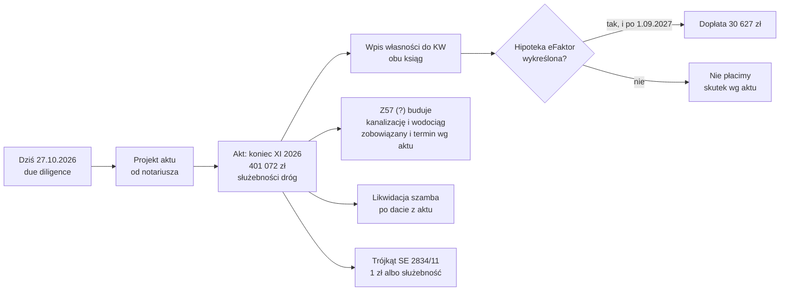

# Transakcja – cena, płatność i zapisy aktu

Strona opisuje, ile i kiedy płacimy, co dostajemy i co musi być w akcie notarialnym. Każdy warunek z maila ma tu ryzyko i proponowane zabezpieczenie. Pełna lista kontrolna: [[dzs-checklista-przed-zakupem]].

## Cena

| Działka | Netto | VAT 23% | Brutto | Netto za m² | Brutto za m² |
|---|---|---|---|---|---|
| 2834/8 (833 m²) | 145 775,00 zł | 33 528,25 zł | 179 303,25 zł | 175 zł | 215,25 zł |
| 2834/9 (777 m²) | 155 400,00 zł | 35 742,00 zł | 191 142,00 zł | 200 zł | 246,00 zł |
| 2834/11 (249 m²) | 49 800,00 zł | 11 454,00 zł | 61 254,00 zł | 200 zł | 246,00 zł |
| **Razem (1859 m²)** | **350 975,00 zł** | **80 724,25 zł** | **431 699,25 zł** | śr. 188,80 zł | śr. 232,22 zł |

Źródło: tabela xlsx ([[dzs-oferta-i-mail-z57]]). VAT i ceny za m² obliczone. Mail podaje 431 699 zł (zaokrąglenie o 0,25 zł).

Dodatkowe koszty zakupu (taksa notarialna maks. ok. 1 535,53 zł brutto, wpisy w KW ok. 600–1000 zł, PCC 0 zł): [[dzs-koszty-zakupu-i-podatki]].

## Płatność

| Rata | Kwota | Kiedy | Warunek |
|---|---|---|---|
| Przy akcie | **401 072 zł** | koniec listopada 2026 | podpisanie aktu |
| Odroczona | **30 627 zł** (50% ceny 2834/11) | po wykreśleniu hipoteki eFaktor, **nie wcześniej niż po 1.09.2027** | wykreślenie hipoteki eFaktor (KW do potwierdzenia) |
| Razem | 431 699 zł | | |

Sprawdzenie: 401 072 + 30 627 = 431 699 zł. 61 254 / 2 = 30 627 zł ([[dzs-oferta-i-mail-z57]], warunek 4 (nasza numeracja)).

## Brak umowy przedwstępnej

Mail mówi wprost: akt bez wcześniejszej umowy przedwstępnej ([[dzs-oferta-i-mail-z57]], warunek 3 (nasza numeracja)).

| Ryzyko | Skutek | Zabezpieczenie |
|---|---|---|
| Sprzedający sprzeda komuś innemu | tracimy działki i koszty przygotowań | poproś o list intencyjny lub krótką umowę rezerwacyjną; nie płać nic przed aktem |
| Zmiana ceny lub warunków | negocjacje od nowa | ustal projekt aktu na piśmie min. 2 tygodnie przed terminem |
| Płatność gotówką/przelewem w dniu aktu | ryzyko, że pieniądze odejdą, a wpis się opóźni | **depozyt notarialny**: wpłać 401 072 zł do depozytu; notariusz wypłaca po podpisaniu aktu |
| Brak kredytu na czas (jeśli finansujecie kredytem) | nie zdążycie do końca XI | wcześniej zbierz dokumenty dla banku |

> [!warning] Nie płaćcie zaliczki bez umowy
> Bez umowy przedwstępnej każda wpłata przed aktem jest niezabezpieczona. Płaćcie dopiero przy akcie, najlepiej przez depozyt notarialny.

## Odroczona płatność i hipoteka eFaktor

Wniosek z maila: hipoteka eFaktor najpewniej obciąża KW KR1Y/00059868/1 ([[dzs-dzialka-2834-11]]), bo odroczenie dotyczy ceny tej działki. Nie sprawdzono tego w EKW. Sprawdź dział IV obu ksiąg: KR1Y/00059868/1 i KR1Y/00091772/7 ([[dzs-z57-real-estate]]).

> [!question] Do sprawdzenia
> Na której księdze jest hipoteka eFaktor? Odczytaj dział IV obu ksiąg w EKW.

> [!warning] Hipoteka przechodzi z działką
> Hipoteka obciąża działkę, nie sprzedającego. Po zakupie wierzyciel może prowadzić egzekucję z naszej 2834/11. Dlatego 30 627 zł płacimy dopiero po wykreśleniu.

Klauzule do aktu:

- Zgoda wierzyciela eFaktor na **bezobciążeniowe odłączenie** 2834/11 – najlepiej przedstawiona przy akcie. Wtedy odroczenie jest tylko dodatkowym zabezpieczeniem ([[dzs-z57-real-estate]]).
- Data graniczna wykreślenia (np. 31.12.2027). Skutek po tej dacie: obniżenie ceny lub prawo do spłaty wierzyciela z odroczonej kwoty.
- Termin dopłaty: np. 14 dni od doręczenia odpisu KW bez hipoteki, nie wcześniej niż 2.09.2027.
- Brak odsetek od odroczonej kwoty.
- Ewentualne poddanie się egzekucji (art. 777 kpc) tylko do kwoty 30 627 zł i tylko z tym warunkiem.

> [!question] Do sprawdzenia
> Jaka jest kwota hipoteki eFaktor? Czy obejmuje też inne działki? Odczytaj dział IV KW KR1Y/00059868/1 w EKW ([[dzs-checklista-przed-zakupem]]).

## Trójkąt w SE narożniku 2834/11

Mail: zobowiązanie do sprzedaży za 1 zł albo służebność dla „każdoczesnego właściciela działki poniżej” ([[dzs-oferta-i-mail-z57]], warunek 5 (nasza numeracja)). Wg geometrii ULDK to ok. 2,2 m² przy działce 2834/13 – to interpretacja, nie dane z maila ([[dzs-dzialka-2834-11]]).

| Wariant | Plusy | Minusy |
|---|---|---|
| Sprzedaż za 1 zł | granica prosta, koniec sprawy | podział geodezyjny (koszt, czas); możliwy PIT, liczony od wartości rynkowej (art. 19 ustawy o PIT), jeśli sprzedaż nastąpi przed upływem 5 lat od końca roku nabycia (art. 10 ust. 1 pkt 8). Przy akcie w XI 2026 to sprzedaż do 31.12.2031; PCC po stronie kupującego ([[dzs-koszty-zakupu-i-podatki]]) |
| Służebność gruntowa | bez podziału, bez podatku od sprzedaży | trwałe obciążenie KW; trzeba dokładnie opisać obszar na mapie |

Klauzule: obszar w m² na mapie geodety (załącznik), numer działki władnącej, kto płaci geodetę i notariusza (sprzedający), termin wykonania. Podział dla regulacji granicy sąsiada nie musi spełniać min. 600 m² ([[dzs-mpzp-uchwala]] §24 ust. 3 pkt 2).

## Służebności dróg dojazdowych

Działki nie graniczą z drogą publiczną. Na wschodzie są prywatne pasy 725/41 (ok. 4,9 m) i 726/1 (ok. 3,3 m), grupa rejestrowa 15 ([[dzs-dzialka-2834-9]], [[dzs-uzbrojenie-terenu]]). W MPZP pas nie ma symbolu drogi ([[dzs-dokumenty-i-linki]]).

Klauzule do aktu:

- Służebność przejazdu i przechodu na **całej trasie** do drogi publicznej, z numerami wszystkich działek obciążonych.
- Na rzecz każdoczesnego właściciela 2834/8, 2834/9 i 2834/11.
- Pas min. 5,0 m szerokości (dojazd nie wydzielony, [[dzs-mpzp-uchwala]] §24 ust. 7).
- Prawo prowadzenia przyłączy (woda, kanalizacja, prąd, telekom) w pasie służebności.
- Kto utrzymuje i odśnieża drogę, kto płaci.
- Wynagrodzenie jednorazowe wliczone w cenę.

> [!question] Do sprawdzenia
> Gdzie pas 725/41 / 726/1 łączy się z drogą publiczną? Kto jest właścicielem każdego odcinka? Bez całej trasy służebność nie daje dostępu ([[dzs-ryzyka]]).

## Zobowiązania sprzedającego: kanalizacja i wodociąg

Mail obiecuje „konkretne zobowiązania dotyczące terminowej budowy” sieci ([[dzs-oferta-i-mail-z57]], warunek 7 (nasza numeracja)). Nie ma publicznego planu gminy dla tego miejsca, więc sieć jest najpewniej prywatna ([[dzs-dostawcy-mediow]]).

Klauzule do aktu:

- Konkretna data oddania sieci do użytku (np. 30.06.2027).
- Punkt przyłączenia na granicy 2834/9 (studzienka, zasuwa).
- Kara umowna za każdy dzień zwłoki.
- Prawo wykonania zastępczego na koszt sprzedającego.
- Kto będzie właścicielem i operatorem sieci; zobowiązanie przekazania sieci gminie (operator wod-kan to Gmina Siepraw).
- Służebność przesyłu dla sieci, jeśli biegnie przez nasze działki.
- Brak opłat za przyłączenie po naszej stronie (albo ich wysokość).

> [!warning] Sieć a szambo
> Opinia geotechniczna zaleca, aby nie wykonywać urządzeń, które nawadniają grunt, w tym przydomowej oczyszczalni i studni chłonnych ([[dzs-opinia-geotechniczna]] s. 9, wniosek 14). To zalecenie geotechnika, nie zakaz prawny, ale projektant powinien je uwzględnić. Bez kanalizacji zostaje tylko szczelne szambo. Termin budowy sieci decyduje, czy dom ruszy bez szamba ([[dzs-mpzp-infrastruktura-i-komunikacja]]).

Kapitał zakładowy sprzedającego to 250 000 zł ([[dzs-z57-real-estate]]). Kara umowna bez zabezpieczenia może być trudna do ściągnięcia. Rozważ zatrzymanie części ceny lub gwarancję.

## Istniejące szambo

Na 2834/9 stoi obiekt ok. 2,5 × 2,5 m, ok. 3–4 m od wschodniej granicy. Prowadzi do niego przewód kanalizacyjny od domu na 2834/6 ([[dzs-uzbrojenie-terenu]], [[dzs-dzialka-2834-9]]). Służebności nie ma ([[dzs-oferta-i-mail-z57]], warunek 8 (nasza numeracja)).

Klauzule do aktu:

- Konkretna data, po której możemy zlikwidować szambo i przewód.
- Kto likwiduje i płaci (sprzedający), w jakim terminie.
- Sposób: wypompowanie, dezynfekcja, wyjęcie zbiornika, zasypka zagęszczona (nie gruz) – ważne pod podjazd i garaż ([[dzs-warunki-gruntowe]]).
- Oświadczenie sprzedającego, że sąsiad zostanie przyłączony do nowej sieci przed datą likwidacji.
- Oświadczenie, że sprzedający nie ustanowił i nie ustanowi służebności dla szamba.

## Weryfikacja

- 2026-10-27: sprawdzono ze źródłami pierwotnymi; poprawiono 10 miejsc (zob. [[dzs-raport-weryfikacji-2026-10-27]]).

## Powiązane

- [[dzialki-siepraw]] · [[dzs-mapa-mysli.canvas]]
- [[dzs-oferta-i-mail-z57]] · [[dzs-z57-real-estate]] · [[dzs-koszty-zakupu-i-podatki]]
- [[dzs-checklista-przed-zakupem]] · [[dzs-ryzyka]] · [[dzs-harmonogram]]
- [[dzs-dzialka-2834-8]] · [[dzs-dzialka-2834-9]] · [[dzs-dzialka-2834-11]]
- [[dzs-uzbrojenie-terenu]] · [[dzs-dostawcy-mediow]] · [[dzs-slownik]]
