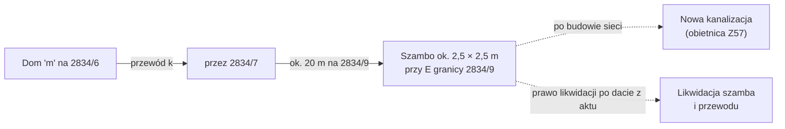

# Uzbrojenie terenu — sieci na działkach i w pobliżu

Przegląd sieci (woda, kanalizacja, prąd, gaz, telekom), które przechodzą przez działki lub leżą obok. Strona wyjaśnia, co sieci znaczą dla budowy domu na [[dzs-dzialka-2834-9]] i gdzie mogą być przyłącza. Dane pochodzą z KIUT (GESUT) GUGiK, stan 2026-10-27.

> [!warning] Dane przybliżone
> Przebieg sieci odczytano ze zrzutu mapy WMS (4 px/m). Długości są przybliżone. Usługa nie podaje średnic, właścicieli ani głębokości. Nie projektuj na tych danych. Zamów mapę do celów projektowych u geodety (`2026-10-27-dzs-gis-manifest.md`).

## Podsumowanie

| Sieć | 2834/8 | 2834/9 | 2834/11 | Najbliżej / uwagi |
|---|---|---|---|---|
| Wodociągowa | **przecina, ok. 20,5 m** | brak | brak | ukośnie N–S przez zachodnią część 2834/8 |
| Kanalizacyjna | brak | **na działce, ok. 19,8 m** | brak | przewód z północy do szamba przy E granicy 2834/9 |
| Elektroenergetyczna | **ok. 65,5 m** | **ok. 41,0 m** | brak (do 3 m: tak) | „eN” wzdłuż północnej granicy; linia w pasie 725/41 na wschodzie |
| Gazowa | brak | brak | brak | ok. 47 m na SW od 2834/8 |
| Telekomunikacyjna | brak | brak | brak | brak w zasięgu mapy |
| Ciepłownicza, specjalna, niezidentyfikowana | brak | brak | brak | brak w zasięgu mapy |
| Urządzenia (`przewod_urzadzenia`) | ok. 1,2 m | ok. 18,2 m | brak (do 3 m: tak) | punkty i obiekty na sieciach, m.in. szambo |

Źródło: `dzs-kiut-przeciecia.json` (pole `inside_m`), `dzs-mapa-uzbrojenie.png`.

![[dzs-mapa-uzbrojenie.png]]

Kolory na mapie (standard GESUT): niebieski = woda, brązowy = kanalizacja, czerwony = prąd, żółty = gaz. Czarna linia wzdłuż wschodniej granicy w pasie 725/41 nie ma opisu.

> [!question] Do sprawdzenia
> Co to za czarna linia w pasie 725/41 wzdłuż wschodniej granicy 2834/9 i 2834/11? Może to być sieć o nieznanym typie albo element innej warstwy KIUT. Sprawdź na mapie do celów projektowych.

## Wodociąg

- Przewód wodociągowy biegnie ukośnie z północy na południe przez zachodnią część [[dzs-dzialka-2834-8]].
- Wchodzi przez północną granicę ok. 8 m od NW narożnika i wychodzi przez południową granicę ok. 7 m od SW narożnika (odczyt z `dzs-mapa-uzbrojenie.png`).
- Długość na działce: ok. 20,5 m (`dzs-kiut-przeciecia.json`).
- Na północy, przy działkach 2834/2–2834/4, biegnie druga sieć wodociągowa wzdłuż osi W–E.
- Do 2834/9 jest ok. 27–30 m od przewodu na 2834/8.

> [!question] Do sprawdzenia
> Kto jest właścicielem wodociągu (gmina, spółka wodna, sprzedający)? Czy w KW KR1Y/00091772/7 jest wpisana służebność przesyłu? Jaki pas ochronny wymaga gestor? Kontakty: [[dzs-dostawcy-mediow]].

## Kanalizacja i szambo

- Przewód kanalizacyjny zaczyna się przy budynku „m” na działce 2834/6 (północ). Biegnie na wschód przez 2834/7, potem na południe.
- Wchodzi na [[dzs-dzialka-2834-9]] przez północną granicę ok. 4 m od NE narożnika. Kończy się w małym obiekcie ok. 2,5 × 2,5 m, ok. 3–4 m od wschodniej granicy.
- Długość na 2834/9: ok. 19,8 m (`dzs-kiut-przeciecia.json`).
- Obiekt to prawdopodobnie **szambo**. Mail sprzedającego mówi o „likwidacji istniejącego szamba”, które „obecnie nie ma służebności” ([[dzs-oferta-i-mail-z57]]).
- Sprzedający obiecuje w akcie zobowiązania do terminowej budowy sieci kanalizacyjnej i wodociągowej ([[dzs-oferta-i-mail-z57]]).

> [!warning] Prawdopodobnie szambo sąsiada (z 2834/6) na działce pod dom
> Położenie i właściciela szamba wywnioskowano z mapy KIUT. Mail mówi tylko o „istniejącym szambie” bez służebności. Potwierdź to u sprzedającego.
> Nie podpisuj aktu bez konkretnej daty likwidacji szamba i przewodu. Wpisz, kto płaci za likwidację i rekultywację. Wpisz karę umowną za opóźnienie budowy sieci. Bez tego sąsiad może żądać służebności (np. przez zasiedzenie lub sąd). Szczegóły: [[dzs-transakcja]], [[dzs-ryzyka]].

> [!question] Do sprawdzenia
> Czy do szamba podłączony jest tylko dom na 2834/6? Jaki termin budowy sieci kanalizacyjnej i wodociągowej podaje sprzedający? Kto będzie właścicielem nowych sieci (gmina czy spółka)?

## Prąd (sieć elektroenergetyczna)

- Przewód z opisem „eN” (niskie napięcie) biegnie wzdłuż północnej granicy 2834/8 i 2834/9, ok. 1 m wewnątrz działek.
- Przy NW narożniku 2834/8 linia skręca na południe i wychodzi na zachód ok. 12–13 m od narożnika. Tam stoi punkt „urządzenia” (ok. 1,2 m na mapie).
- Z północy, wzdłuż zachodniej granicy 2834/8 (ok. 2–3 m wewnątrz działki), biegnie druga linia elektroenergetyczna. Łączy się z linią z zachodu w punkcie ok. 12–13 m na S od NW narożnika, wewnątrz działki (odczyt z `dzs-mapa-uzbrojenie.png`, dokładność ok. 1 m).
- Przy NE narożniku 2834/9 dochodzi linia z północnego wschodu. W tym miejscu jest skupisko punktów „e”. To prawdopodobnie złącze kablowe albo słup.
- Druga linia biegnie na południe w pasie 725/41, wzdłuż wschodniej granicy 2834/9 i 2834/11.
- Długość na działkach: 2834/8 ok. 65,5 m, 2834/9 ok. 41,0 m (`dzs-kiut-przeciecia.json`).

> [!question] Do sprawdzenia
> Czy „eN” to kabel w ziemi, czy linia napowietrzna? Jaki pas wolny od zabudowy wymaga operator (prawdopodobnie Tauron Dystrybucja)? Czy w KW jest służebność przesyłu? Czy przy NE narożniku 2834/9 jest złącze, z którego dostaniemy przyłącze? Kontakty: [[dzs-dostawcy-mediow]].

## Gaz

- Na działkach i w odległości 3 m nie ma sieci gazowej (`dzs-kiut-przeciecia.json`).
- Najbliższy przewód gazowy biegnie ukośnie (NW–SE) ok. 47 m na południowy zachód od SW narożnika 2834/8 (odczyt z `dzs-mapa-uzbrojenie.png`).
- Na rysunku MPZP (`dzs-mpzp-rysunek-dzialki.png`) w tym rejonie biegnie żółta linia ze strefą. To może być ten sam gazociąg.
- Na rysunku MPZP żółta linia ze strefą to według legendy gazociąg wysokiego ciśnienia (DN 200, DN 300 lub DN 500) ze strefą kontrolowaną. Jest to element informacyjny, a nie ustalenie planu ([[dzs-mpzp-uchwala]] § 4 ust. 3 pkt 5).
- Wzdłuż gazociągów trzeba zachować strefy kontrolowane według przepisów odrębnych (§ 53 ust. 4 pkt 2).
- Wniosek: dom zwykle nie dostaje przyłącza wprost z sieci wysokiego ciśnienia. Szerokość strefy i możliwość przyłącza sprawdź w PSG lub GAZ-SYSTEM.

> [!question] Do sprawdzenia
> Jakie ciśnienie ma gazociąg na SW? Czy jego strefa kontrolowana sięga do działek? Czy jest możliwe przyłącze gazu do 2834/9? Patrz [[dzs-mpzp-infrastruktura-i-komunikacja]] i [[dzs-dostawcy-mediow]].

## Telekomunikacja

W zasięgu mapy (działki + 40 m) KIUT nie pokazuje sieci telekomunikacyjnej (`dzs-kiut-przeciecia.json`). Internet może wymagać łącza radiowego, LTE/5G albo nowej linii.

## Co to znaczy dla budowy

| Temat | Co oznacza | Co zrobić |
|---|---|---|
| Strefy wokół sieci | Nad siecią i obok niej zwykle nie wolno stawiać budynku ani sadzić drzew. Szerokość pasa podaje gestor sieci. | Zapytaj gestorów o pasy ochronne. Zaznacz je na mapie do celów projektowych. |
| Służebność przesyłu | Sieć obcego właściciela może mieć tytuł prawny (służebność przesyłu wpisaną w KW, umowę, zasiedzenie) albo nie mieć go wcale. Brak wpisu w KW nie oznacza braku tytułu. Gdy strony nie zawrą umowy, każda z nich może żądać ustanowienia służebności w sądzie: przedsiębiorca – za odpowiednim wynagrodzeniem dla właściciela, a właściciel gruntu – w zamian za odpowiednie wynagrodzenie (art. 305² § 1 i § 2 KC). Potwierdź u prawnika. | Sprawdź dział III KW obu ksiąg. Zapytaj sprzedającego o umowy z gestorami. |
| Przełożenie sieci | MPZP dopuszcza przebudowę sieci, które kolidują z nowymi obiektami ([[dzs-mpzp-uchwala]] § 53 ust. 1 pkt 6). Kto płaci, zależy od tytułu prawnego sieci. Gdy sieć ma tytuł (np. służebność), koszt przełożenia zwykle ponosi inwestor. Gdy tytułu nie ma, właściciel może mieć roszczenie wobec właściciela sieci (art. 222 § 2 KC). Potwierdź u prawnika i w umowie z gestorem. | Projektuj dom tak, aby nie przekładać sieci. Gdy to konieczne, zapytaj gestora o warunki i koszt. |
| Szambo i przewód | Obcy obiekt bez służebności. Sprzedający obiecuje likwidację. | Zapisz w akcie datę, koszt i karę umowną. |
| Wodociąg na 2834/8 | Przewód przecina zachodnią część 2834/8 (ok. 20,5 m). Wniosek: nie stawiaj budynku nad przewodem ani w jego pasie ochronnym (szerokość poda gestor), chyba że sieć zostanie przełożona (MPZP § 53 ust. 1 pkt 6). | Planuj tam ogród lub trawnik albo zapytaj gestora o przełożenie. |
| Linia „eN” na N | Pas przy północnej granicy jest zajęty. | Dom i tak stoi kilka metrów od granicy ([[dzs-warunki-techniczne-odleglosci]]). Unikaj drzew nad kablem. |

> [!question] Do sprawdzenia
> Zasady wynagrodzenia za służebność przesyłu i kosztów przełożenia sieci potwierdź u notariusza lub prawnika. Ta strona podaje zasady ogólne, nie poradę prawną.

## Gdzie przyłącza do domu na 2834/9

| Medium | Prawdopodobne miejsce | Uwagi |
|---|---|---|
| Prąd | NE narożnik 2834/9 (skupisko „e”) albo pas 725/41 | Wniosek o warunki przyłączenia do operatora. Krótka trasa, jeśli garaż stoi przy NE narożniku. |
| Woda | nowa sieć obiecana przez Z57 (mail nie podaje trasy; zapytaj sprzedającego o trasę i rzędne); albo wodociąg na 2834/8 (ok. 30 m) | Termin budowy sieci musi być w akcie. Przyłącze z 2834/8 jest dłuższe, ale biegnie po naszej działce. |
| Kanalizacja | nowa sieć obiecana przez Z57 | Do czasu budowy: własne szambo lub przydomowa oczyszczalnia (sprawdź MPZP i [[dzs-warunki-gruntowe]]). Teren opada na S, więc grawitacja działa w stronę południa, a droga jest na wschodzie. MPZP dopuszcza szczelny zbiornik i przydomową oczyszczalnię ([[dzs-mpzp-uchwala]] § 53 ust. 3 pkt 4). W obszarach osuwisk z § 12 ścieków i wód opadowych nie wolno odprowadzać do gruntu (§ 53 ust. 3 pkt 6, § 12 ust. 2 pkt 2). Opinia geotechniczna odradza urządzenia, które nawadniają podłoże ([[dzs-opinia-geotechniczna]], wniosek 14). Szamba nie wolno postawić, gdy działka może być przyłączona do kanalizacji (WT § 34 ust. 1, patrz [[dzs-warunki-techniczne-odleglosci]]). Sprawdź w SOPO i w wypisie, czy działki leżą w obszarze osuwisk. |
| Gaz | Brak sieci na działkach i do 3 m od nich. Najbliższy przewód gazowy jest ok. 47 m na SW od 2834/8 (według MPZP prawdopodobnie gazociąg wysokiego ciśnienia) | Zapytaj PSG, czy przyłącze jest możliwe. Wniosek: gdy gazu nie będzie, rozważ pompę ciepła i PV. |
| Wody opadowe | na własnej działce | Retencja w niższej części (S, SW). Sprawdź przepuszczalność gruntu: [[dzs-opinia-geotechniczna]]. Rozsączanie jest zakazane w obszarach osuwisk (§ 12) i odradza je opinia geotechniczna (wniosek 14). |

> [!question] Do sprawdzenia
> Jeśli nowa sieć kanalizacyjna będzie leżeć wyżej niż wyjście z budynku (np. w drodze na wschodzie – to założenie, trasy nie znamy), może być potrzebna przepompownia. Zapytaj projektanta po otrzymaniu rzędnych sieci.

## Weryfikacja

- 2026-10-27: sprawdzono ze źródłami pierwotnymi; poprawiono 9 miejsc (zob. [[dzs-raport-weryfikacji-2026-10-27]]).

## Powiązane

- [[dzialki-siepraw]] · [[dzs-mapa-mysli.canvas]]
- [[dzs-dzialka-2834-8]] · [[dzs-dzialka-2834-9]] · [[dzs-dzialka-2834-11]]
- [[dzs-dostawcy-mediow]] · [[dzs-mpzp-infrastruktura-i-komunikacja]] · [[dzs-warunki-techniczne-odleglosci]]
- [[dzs-oferta-i-mail-z57]] · [[dzs-transakcja]] · [[dzs-ryzyka]] · [[dzs-checklista-przed-zakupem]]
- [[dzs-dane-gis-i-3d]] · [[dzs-procedura-budowy]]
- [[dzs-szybkie-odpowiedzi]] · [[dzs-pomysly]] · [[dzs-harmonogram]]
